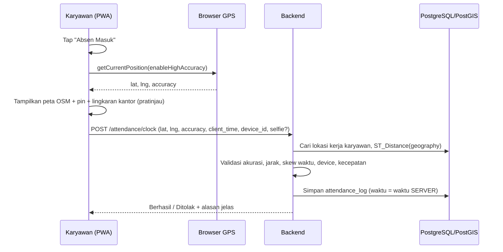
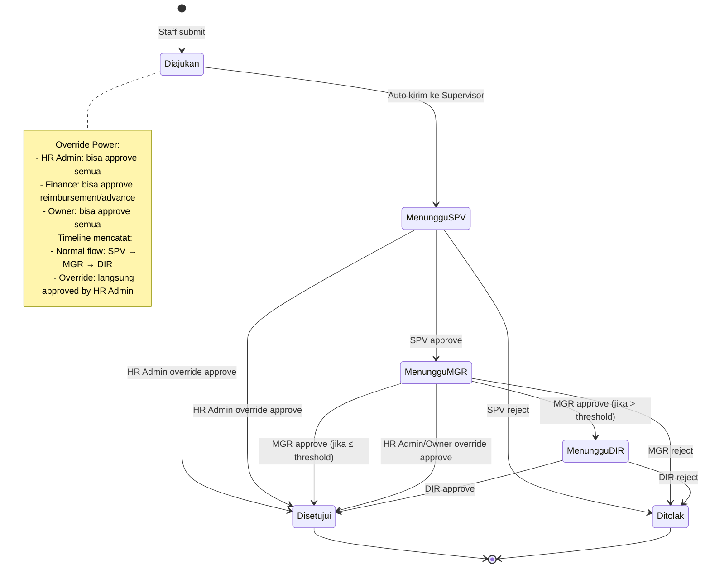
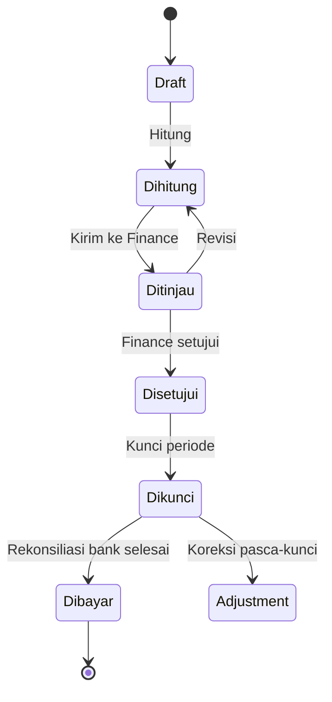
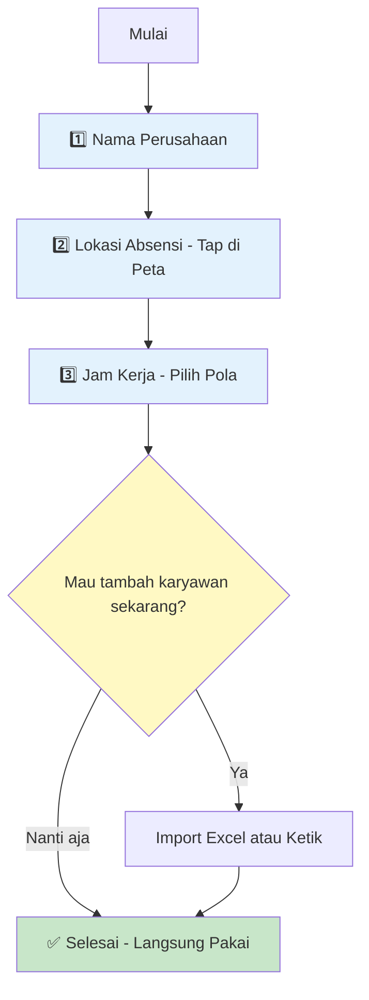
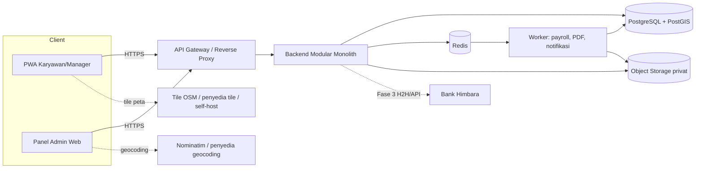
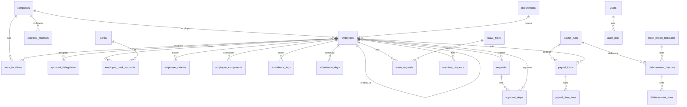

# PRD — HRIS Simple
**Absensi Berbasis OpenStreetMap + Payroll Sederhana Sesuai Ketentuan Kemnaker/DJP + Pencairan Gaji Bank Himbara**

| | |
|---|---|
| **Versi** | 1.0 (Draft untuk review) |
| **Tanggal** | 13 November 2026 |
| **Target pengguna** | UKM / perusahaan 10–500 karyawan di Indonesia |
| **Platform** | Web responsif + PWA (installable di Android/iOS), panel admin desktop |
| **Bahasa antarmuka** | Bahasa Indonesia (default), English (Fase 2) |
| **Catatan** | Dokumen ini adalah spesifikasi produk, bukan nasihat hukum/pajak. Seluruh angka regulasi harus diverifikasi ulang oleh konsultan pajak/hukum ketenagakerjaan sebelum rilis (lihat §8). |

---

## Daftar Isi
1. [Ringkasan Eksekutif](#1-ringkasan-eksekutif)
2. [Masalah & Peluang](#2-masalah--peluang)
3. [Tujuan, Non-Tujuan & Metrik](#3-tujuan-non-tujuan--metrik-sukses)
4. [Persona & Peran](#4-persona--peran)
5. [Ruang Lingkup](#5-ruang-lingkup)
6. [Kebutuhan Fungsional](#6-kebutuhan-fungsional)
7. [Easy Setup — Setup Awal Perusahaan](#7-easy-setup--setup-awal-perusahaan)
8. [Kepatuhan Regulasi](#8-kepatuhan-regulasi-kemnaker-djp-bpjs-uu-pdp)
9. [Arsitektur & Backend](#9-arsitektur--backend)
10. [Desain Database](#10-desain-database)
11. [Desain API](#11-desain-api)
12. [Desain UI/UX](#12-desain-uiux)
13. [Non-Functional Requirements, Keamanan & Privasi](#13-non-functional-requirements-keamanan--privasi)
14. [QA & Acceptance Criteria](#14-qa--acceptance-criteria)
15. [Roadmap](#15-roadmap--milestone)
16. [Risiko](#16-risiko--mitigasi)
17. [Pertanyaan Terbuka](#17-pertanyaan-terbuka)
18. [Lampiran](#18-lampiran)

---

## 1. Ringkasan Eksekutif

**HRIS Simple** adalah sistem HR yang sengaja dibuat ringkas untuk perusahaan yang masih memakai Excel, mesin fingerprint, dan transfer gaji manual. Tiga pilar utama:

1. **Absensi berbasis lokasi (GPS + OpenStreetMap)** — karyawan absen dari HP, lokasi kantor/cabang digambar sebagai lingkaran (geofence) di peta OSM, tanpa perangkat keras tambahan.
2. **Payroll sederhana yang patuh regulasi** — gaji, lembur, potongan, iuran BPJS, PPh 21 (skema TER), dan THR dihitung otomatis dengan parameter yang berlaku per tanggal efektif.
3. **Pencairan gaji ke bank Himbara** (BRI, BNI, Mandiri, BTN) — sistem menghasilkan file pembayaran massal sesuai template bank, dengan alur maker–checker; integrasi langsung (H2H/API) menyusul di fase berikutnya.

Prinsip desain: **satu layar = satu tujuan**, istilah sehari-hari, dan setiap angka payroll bisa ditelusuri rumusnya.

---

## 2. Masalah & Peluang

| Masalah saat ini | Dampak | Solusi di HRIS Simple |
|---|---|---|
| Absensi manual / fingerprint, sulit untuk tim lapangan & multi-cabang | Data tidak akurat, titip absen | GPS + geofence OSM, selfie opsional, flag anomali |
| Hitung gaji, lembur, BPJS, PPh 21 di Excel | Salah hitung, tidak konsisten, sulit diaudit | Mesin hitung dengan parameter ber-tanggal-efektif + jejak rumus |
| Aturan berubah (TER, batas upah JP naik tiap tahun) | Risiko selisih bayar/pajak | Parameter regulasi disimpan di database, bukan hardcode |
| Transfer gaji satu per satu / file bank diketik manual | Lambat, rawan salah rekening | Export file bank otomatis + validasi rekening + maker–checker |
| HR jadi bottleneck (cuti, slip gaji, koreksi absen) | Waktu HR habis untuk hal administratif | Self-service karyawan & approval dari HP |

---

## 3. Tujuan, Non-Tujuan & Metrik Sukses

### 3.1 Tujuan
- **G1** Karyawan bisa absen dalam **≤ 3 ketukan** dan **≤ 5 detik** (p95) pada jaringan 4G.
- **G2** HR bisa menjalankan payroll bulanan untuk 100 karyawan dalam **≤ 15 menit** (dari buka periode sampai file bank siap).
- **G3** Hasil hitung payroll **identik** dengan kasus uji yang diverifikasi konsultan pajak (0 selisih).
- **G4** Tidak ada angka regulasi yang di-hardcode; perubahan parameter cukup lewat data (tanpa deploy ulang).
- **G5** UI yang bisa dipakai karyawan tanpa pelatihan (target skor SUS ≥ 80).

### 3.2 Non-Tujuan (MVP)
- Rekrutmen/ATS, performance review, e-learning, manajemen aset.
- Face recognition / biometrik (menghindari pemrosesan data biometrik yang tergolong data pribadi spesifik menurut UU PDP).
- Pegawai harian/borongan & PPh 21 TER harian (Fase 2).
- Integrasi langsung Coretax/e-Bupot dan e-SPT (MVP hanya export CSV/XLSX).
- Aplikasi native iOS/Android (MVP memakai PWA).
- Multi-perusahaan/multi-tenant penuh (skema sudah siap, UI belum).

### 3.3 Metrik Sukses (90 hari setelah go-live)
| Metrik | Target |
|---|---|
| Karyawan aktif mingguan / total karyawan | ≥ 90% |
| Waktu absen end-to-end (p95) | < 5 detik |
| Absensi ditandai anomali yang dikonfirmasi valid oleh HR | < 5% dari total absen |
| Waktu proses payroll (100 karyawan) | ≤ 15 menit |
| Pengurangan tiket "slip gaji / sisa cuti" ke HR | ≥ 60% |
| Kesalahan rekening/jumlah pada file bank | 0 |

---

## 4. Persona & Peran

| Persona | Peran sistem | Kebutuhan utama | Konteks |
|---|---|---|---|
| **Budi**, 27, staf operasional | `employee` | Absen cepat, lihat slip gaji & sisa cuti | HP Android menengah, sinyal kadang lemah |
| **Rina**, 29, HR 1-orang | `hr_admin` | Kelola karyawan, jadwal, cuti, jalankan payroll tanpa Excel | Desktop + HP, tekanan tenggat tanggal gajian |
| **Pak Hendra**, 41, manajer | `manager` | Approve cuti/lembur/koreksi absen dari HP | Sering di luar kantor |
| **Sari**, 35, finance | `finance` | Setujui payroll, unduh file bank, rekonsiliasi | Memakai portal cash management bank |
| **Ibu Lestari**, pemilik | `owner` | Ringkasan biaya SDM, kehadiran | Hanya butuh dashboard ringkas |

### Matriks Hak Akses (RBAC)
| Fitur | employee | manager | hr_admin | finance | owner |
|---|:-:|:-:|:-:|:-:|:-:|
| Absen & lihat riwayat sendiri | ✅ | ✅ | ✅ | ✅ | ✅ |
| Ajukan cuti / lembur / koreksi | ✅ | ✅ | ✅ | ✅ | ✅ |
| Approve pengajuan tim | — | ✅ (tim sendiri) | ✅ | — | ✅ |
| Kelola data karyawan | — | lihat tim | ✅ | lihat | ✅ |
| Lihat gaji karyawan lain | — | — | ✅ | ✅ | ✅ |
| Hitung payroll (draft) | — | — | ✅ | ✅ | ✅ |
| **Setujui & kunci** payroll | — | — | — | ✅ | ✅ |
| Generate / unduh file bank | — | — | — | ✅ | ✅ |
| Parameter regulasi & template bank | — | — | ✅ (usul) | ✅ (setujui) | ✅ |
| Audit log | — | — | lihat | lihat | ✅ |

> **Prinsip maker–checker:** orang yang menghitung payroll **tidak boleh** menjadi orang yang menyetujui dan mengunduh file bank (bisa dilonggarkan pada perusahaan sangat kecil lewat pengaturan, dengan peringatan).

---

## 5. Ruang Lingkup

| Modul | MVP (Fase 1–2) | Fase 3 | Di luar lingkup |
|---|---|---|---|
| Autentikasi & akun | Email/HP + password, reset, 2FA TOTP (HR/Finance) | SSO Google | SAML enterprise |
| Data karyawan | Profil, kontrak, rekening, PTKP, BPJS, dokumen dasar | Import massal lanjutan, org chart | ATS |
| **Absensi OSM** | Geofence lingkaran, clock in/out, selfie opsional, shift, koreksi, live monitor | Geofence poligon, mode offline, app native (deteksi mock GPS) | Face recognition |
| Cuti & izin | Jenis cuti, saldo, pengajuan, approval, kalender tim | Cuti kolektif/cuti bersama otomatis, carry-over lanjutan | — |
| Lembur | Pengajuan, approval, hitung otomatis PP 35/2021 | Lembur otomatis dari absensi | — |
| **Payroll** | Komponen gaji, BPJS, PPh 21 TER + Desember + resign, THR, prorata, slip gaji | Harian/borongan, gross-up, reimburse, kasbon lanjutan | Konsolidasi multi-entitas |
| **Bank Himbara** | Export file per bank (template), maker–checker, rekonsiliasi manual | H2H SFTP / API (BI-SNAP), status real-time | Pembukaan rekening otomatis |
| Laporan | Rekap absensi, payroll, BPJS, PPh 21 (CSV/XLSX/PDF) | Format import Coretax/e-Bupot | e-SPT |
| Notifikasi | In-app, email, WhatsApp (opsional, via provider) | Push notification | — |

---

## 6. Kebutuhan Fungsional

> Prioritas: **P0** = wajib MVP, **P1** = penting, **P2** = menyusul.

### 6.1 Autentikasi & Akun
| ID | Kebutuhan | Prio |
|---|---|---|
| FR-AUTH-01 | Login email/nomor HP + password; password di-hash **argon2id** | P0 |
| FR-AUTH-02 | Akun karyawan dibuat HR; karyawan menerima undangan (link sekali pakai, kedaluwarsa 48 jam) | P0 |
| FR-AUTH-03 | Access token 15 menit + refresh token rotasi; logout di semua perangkat | P0 |
| FR-AUTH-04 | 2FA TOTP **wajib** untuk `hr_admin`, `finance`, `owner` | P0 |
| FR-AUTH-05 | Kunci akun sementara setelah 5 percobaan gagal (15 menit) + notifikasi | P1 |
| FR-AUTH-06 | Lupa password via email/WhatsApp OTP | P0 |

### 6.2 Data Karyawan
| ID | Kebutuhan | Prio |
|---|---|---|
| FR-EMP-01 | CRUD karyawan: nomor induk, nama, NIK (16 digit), tgl lahir, kontak, alamat, departemen, jabatan, atasan | P0 |
| FR-EMP-02 | Status hubungan kerja: probation, PKWT, PKWTT, magang, resign, PHK; tanggal mulai/berakhir kontrak | P0 |
| FR-EMP-03 | Status **PTKP** (TK/0–TK/3, K/0–K/3) → otomatis menentukan kategori TER (A/B/C) | P0 |
| FR-EMP-04 | NPWP/NIK, No. BPJS Kesehatan & Ketenagakerjaan | P0 |
| FR-EMP-05 | Rekening bank karyawan (≥1 primer) + status verifikasi | P0 |
| FR-EMP-06 | Riwayat gaji pokok & komponen (ber-tanggal efektif; tidak menimpa data lama) | P0 |
| FR-EMP-07 | Import karyawan dari template XLSX dengan validasi & preview error per baris | P1 |
| FR-EMP-08 | Pengingat kontrak PKWT akan berakhir (30 hari sebelumnya) | P1 |
| FR-EMP-09 | Karyawan dapat mengubah data kontak/foto sendiri; perubahan rekening bank wajib persetujuan HR | P0 |
| FR-EMP-10 | Soft-delete; data karyawan resign tetap tersimpan sesuai kebijakan retensi | P0 |

### 6.3 Absensi dengan OpenStreetMap

#### 6.3.1 Alur Absen (karyawan)


#### 6.3.2 Kebutuhan
| ID | Kebutuhan | Prio |
|---|---|---|
| FR-ABS-01 | **Satu tombol sadar-konteks**: "Absen Masuk" → "Absen Pulang" sesuai status hari itu | P0 |
| FR-ABS-02 | Ambil lokasi via HTML5 Geolocation (`enableHighAccuracy: true`, timeout 15 dtk, `maximumAge: 0`); wajib HTTPS | P0 |
| FR-ABS-03 | **Validasi geofence di server** (bukan di klien): `ST_Distance(geography) ≤ radius_m` **dan** `accuracy_m ≤ max_accuracy_m` (default 50 m, bisa diatur) | P0 |
| FR-ABS-04 | Karyawan bisa ditugaskan ke >1 lokasi kerja; sistem memakai lokasi terdekat yang ditugaskan | P0 |
| FR-ABS-05 | Radius per lokasi: default **100 m**, min 20 m, maks 2.000 m | P0 |
| FR-ABS-06 | Peta di UI memakai **Leaflet + tile OpenStreetMap**, menampilkan posisi pengguna, lingkaran area absen, dan jarak ("35 m dari Kantor Pusat") | P0 |
| FR-ABS-07 | **Waktu absen = waktu server** (UTC, ditampilkan sesuai zona waktu lokasi: WIB/WITA/WIT). Waktu perangkat hanya untuk deteksi selisih | P0 |
| FR-ABS-08 | Mode kerja: `onsite` (wajib dalam geofence), `remote` (karyawan berflag WFH atau ada pengajuan WFH disetujui), `field_duty` (dinas luar disetujui) — lokasi tetap dicatat, absen di luar geofence diizinkan tapi diberi label | P0 |
| FR-ABS-09 | Selfie opsional per perusahaan/lokasi: dikompres di klien (≤ 200 KB), disimpan di storage privat, retensi default 90 hari. **Tanpa face matching** di MVP | P1 |
| FR-ABS-10 | **Deteksi anomali** (flag, bukan blok otomatis kecuali di luar geofence): akurasi rendah, selisih waktu perangkat vs server > 2 menit, perangkat baru, "perjalanan mustahil" (kecepatan > 150 km/jam antar dua absen), koordinat identik berulang dengan akurasi 0, jarak IP-geo ekstrem | P0 |
| FR-ABS-11 | **Device binding**: 1 perangkat aktif per karyawan; ganti perangkat memerlukan persetujuan HR | P1 |
| FR-ABS-12 | Jika akurasi rendah: tampilkan saran ("Pindah ke area terbuka") + tombol coba lagi. Setelah 3 kali gagal, boleh "Absen dengan catatan" yang masuk antrean review HR | P0 |
| FR-ABS-13 | Hitung otomatis: terlambat (menit), pulang cepat, jam kerja, status harian (hadir/terlambat/alpa/cuti/sakit/libur) | P0 |
| FR-ABS-14 | Lupa absen pulang: ditandai "Perlu koreksi" pada hari berikutnya; karyawan ajukan **koreksi absen** (alasan wajib) → approval atasan/HR | P0 |
| FR-ABS-15 | **Live monitor HR**: peta OSM berisi penanda absen hari ini (klaster), filter lokasi/departemen/status | P1 |
| FR-ABS-16 | Rekap absensi bulanan per karyawan/departemen; export XLSX/CSV | P0 |
| FR-ABS-17 | Setelah payroll periode **dikunci**, data absensi periode itu read-only; perubahan lewat *adjustment run* | P0 |
| FR-ABS-18 | Mode offline / antrean absen saat sinyal hilang (dengan label "tertunda") | P2 |
| FR-ABS-19 | Geofence poligon (gedung besar, pabrik) | P2 |

#### 6.3.3 Pengaturan Lokasi Kerja (Admin)
| ID | Kebutuhan | Prio |
|---|---|---|
| FR-LOC-01 | Peta OSM interaktif: **klik untuk menaruh pin**, seret untuk menggeser, slider radius dengan lingkaran langsung terlihat | P0 |
| FR-LOC-02 | Tombol "Gunakan lokasi saya sekarang" | P0 |
| FR-LOC-03 | Pencarian alamat via **Nominatim** — dipicu saat pengguna menekan Enter/tombol cari (bukan autocomplete tiap ketikan), User-Agent teridentifikasi, maksimum 1 request/detik | P1 |
| FR-LOC-04 | Setiap lokasi punya zona waktu (Asia/Jakarta, Asia/Makassar, Asia/Jayapura) | P0 |
| FR-LOC-05 | Penugasan karyawan ke lokasi secara massal (per departemen/pilih banyak) | P1 |

#### 6.3.4 Catatan Teknis & Batasan OpenStreetMap
- **Tile server publik OSM (`tile.openstreetmap.org`) bukan untuk lalu lintas produksi besar.** Kebijakan penggunaan OSMF mensyaratkan atribusi, User-Agent/Referer valid, dan melarang pemakaian berat. Strategi: *development* memakai tile OSM publik; *produksi* memakai penyedia tile berbasis data OSM (mis. MapTiler/Stadia/Thunderforest) **atau** self-host (Protomaps PMTiles di object storage / OpenMapTiles). Konfigurasi URL tile lewat environment variable.
- **Atribusi wajib** di peta: `© OpenStreetMap contributors` (lisensi ODbL).
- **Nominatim publik** dibatasi (1 req/dtk, tanpa autocomplete); produksi: self-host atau penyedia geocoding.
- **Browser tidak dapat mendeteksi mock-GPS secara andal.** PWA memakai lapisan mitigasi (akurasi, skew waktu, kecepatan, selfie, device binding, review HR). Deteksi `isMockLocation` yang kuat memerlukan app native (Fase 3). Dokumentasikan batasan ini kepada pemilik usaha.
- Perhitungan jarak memakai tipe `geography` PostGIS (meter akurat di permukaan bumi), bukan hitungan klien.

### 6.4 Shift, Jadwal & Hari Libur
| ID | Kebutuhan | Prio |
|---|---|---|
| FR-SHF-01 | Definisi shift: jam masuk/pulang, istirahat, toleransi terlambat, lintas tengah malam | P0 |
| FR-SHF-02 | Penetapan shift default per karyawan + override per tanggal (termasuk hari libur khusus) | P0 |
| FR-SHF-03 | Pola hari kerja per perusahaan: 5 hari (8 jam) atau 6 hari (7 jam) | P0 |
| FR-SHF-04 | Kalender libur nasional & cuti bersama (diinput admin; template tahunan bisa di-import) | P0 |
| FR-SHF-05 | Jadwal bergilir (rotating) dengan tampilan kalender mingguan | P1 |

### 6.5 Cuti, Izin & Sakit

#### 6.5.1 Approval Workflow Berjenjang

**Prinsip:** Request mengikuti **hierarki organisasi** — staff → supervisor → manager → direktur. Setiap level bisa di-skip jika tidak ada, atau diatur per jenis request.

**Special Rule:** 
- **HR Admin & Finance dapat approve langsung** (override normal flow) untuk semua jenis request
- **Owner/Direktur dapat approve langsung** tanpa perlu menunggu level sebelumnya
- Semua approval tercatat lengkap: **siapa, kapan, di level mana, IP address, device**



#### 6.5.2 Konfigurasi Approval Matrix

Admin HR bisa mengatur **siapa approve apa** dengan aturan:

| Jenis Request | Level 1 | Level 2 | Level 3 | Kondisi Escalation |
|---|---|---|---|---|
| Cuti tahunan ≤ 3 hari | Supervisor | Manager | — | Auto-approve jika < 3 hari & saldo cukup |
| Cuti tahunan > 3 hari | Supervisor | Manager | Direktur | Wajib 3 level |
| Sakit (≤ 2 hari) | Supervisor | — | — | Tanpa surat dokter |
| Sakit (> 2 hari) | Supervisor | Manager + HR | — | Wajib lampiran surat dokter |
| Cuti tanpa upah | Supervisor | Manager | Direktur | Selalu 3 level |
| Lembur ≤ 10 jam/minggu | Supervisor | — | — | — |
| Lembur > 10 jam/minggu | Supervisor | Manager | — | Peringatan batas PP 35/2021 |
| Koreksi absensi | Supervisor | HR | — | HR verifikasi anomali |
| Dinas luar (WFH/field) | Supervisor | — | — | — |
| Reimburse ≤ Rp500K | Supervisor | — | — | — |
| Reimburse > Rp500K | Supervisor | Manager | Finance | — |

**Konfigurasi per perusahaan:** HR bisa ubah threshold, skip level, atau tambah level (mis. VP, Department Head).

#### 6.5.3 Hierarki Organisasi

Sistem memakai **struktur organisasi** untuk menentukan approval path otomatis:

```
Direktur (direktur@company.com)
  ├── Manager Operasional (manager_ops@company.com)
  │   ├── Supervisor A (spv_a@company.com)
  │   │   ├── Staff 1
  │   │   └── Staff 2
  │   └── Supervisor B
  │       └── Staff 3
  └── Manager Finance (manager_fin@company.com)
      └── Staff Finance
```

- **Setiap karyawan punya `reports_to` (UUID atasan langsung)** di tabel `employees`
- Sistem trace hierarki ke atas sampai menemukan level yang sesuai approval matrix
- Jika atasan sedang cuti/tidak aktif → **delegasi** atau **skip ke level atasnya** (configurable)

#### 6.5.4 Fitur Approval

| ID | Kebutuhan | Prio |
|---|---|---|
| FR-LV-01 | Jenis cuti configurable: tahunan, sakit, melahirkan, izin berbayar (menikah, keluarga meninggal, dll.), cuti tanpa upah (unpaid) | P0 |
| FR-LV-02 | Saldo cuti tahunan default **12 hari kerja**, hak muncul setelah 12 bulan kerja terus-menerus (dapat diubah sesuai PP/PKB perusahaan yang lebih menguntungkan) | P0 |
| FR-LV-03 | Pengajuan dari HP: pilih jenis, tanggal, alasan, lampiran (surat dokter) bila diwajibkan | P0 |
| FR-LV-04 | **Approval berjenjang otomatis** berdasarkan hierarki organisasi (`reports_to`) + approval matrix per jenis request | P0 |
| FR-LV-04a | **Override approval oleh HR Admin/Finance/Owner**: bisa approve langsung tanpa menunggu level sebelumnya, dengan label "Approved by [Nama] (HR Admin Override)" | P0 |
| FR-LV-04b | **Approval history lengkap**: tabel `approval_steps` mencatat setiap orang yang approve/reject dengan: nama, role, timestamp, IP address, user agent, komentar (opsional) | P0 |
| FR-LV-05 | **Notifikasi real-time** ke approver berikutnya via in-app, email, WhatsApp (opsional); pemohon diberi tahu status (pending/approved/rejected) | P0 |
| FR-LV-06 | **Delegasi approval**: atasan bisa delegate ke orang lain (mis. saat cuti) dengan tanggal efektif; approval tercatat "Approved by [Delegate] on behalf of [Original Approver]" | P1 |
| FR-LV-07 | **Auto-approve** untuk kasus tertentu (mis. cuti ≤ 1 hari jika saldo cukup & tidak ada bentrok tim) — configurable per perusahaan; tercatat sebagai "Auto-approved (system rule)" | P1 |
| FR-LV-08 | **Bulk approve**: manager bisa approve beberapa request sekaligus dengan 1 klik; masing-masing tercatat individual approval | P1 |
| FR-LV-09 | **Timeline approval** di detail request: tampilan visual (stepper/timeline) menunjukkan:<br>• ✅ Level 1: Approved by Pak Budi (Supervisor) - 14 Jan 2027, 10:23<br>• ✅ Level 2: Approved by Ibu Sari (Manager) - 14 Jan 2027, 14:15<br>• ⏳ Level 3: Waiting for Pak Hendra (Direktur)<br>• Atau: ⚡ Override: Approved by Ibu Rina (HR Admin) - 14 Jan 2027, 09:05 | P0 |
| FR-LV-10 | Hari cuti disetujui otomatis tercermin di status absensi & payroll (unpaid leave memotong gaji) | P0 |
| FR-LV-11 | Validasi: saldo cukup, tidak bentrok dengan cuti yang sudah approved, tidak lewat batas kebijakan | P0 |
| FR-LV-12 | **Kalender cuti tim** (siapa yang off) — manager melihat timnya, HR melihat semua | P1 |
| FR-LV-13 | **Konflik detection**: peringatan jika > X% tim cuti di tanggal sama (threshold per departemen) | P1 |
| FR-LV-14 | Carry-over & kedaluwarsa cuti (konfigurasi) | P2 |
| FR-LV-15 | **Recall request**: pemohon bisa tarik kembali request yang masih pending; tercatat di timeline "Recalled by requester" | P0 |
| FR-LV-16 | **SLA reminder**: jika approver tidak respond dalam X hari kerja → notifikasi reminder + cc ke level atasnya + HR (escalation) | P1 |
| FR-LV-17 | **Export approval log**: HR bisa export CSV semua approval history (untuk audit) dengan kolom: request_id, type, requester, approver, level, action, timestamp, IP, comment | P1 |

### 6.6 Lembur

#### 6.6.1 Approval Workflow Lembur

Lembur mengikuti approval matrix yang sama dengan cuti (§6.5.1), dengan tambahan validasi otomatis:

| ID | Kebutuhan | Prio |
|---|---|---|
| FR-OT-01 | Karyawan/atasan mengajukan lembur (tanggal, jam mulai–selesai, alasan) **sebelum/sesudah** dengan persetujuan tertulis di sistem | P0 |
| FR-OT-02 | **Approval berjenjang** sesuai hierarki + threshold (mis. > 10 jam/minggu perlu manager, > 15 jam perlu direktur) | P0 |
| FR-OT-03 | Batas: maks **4 jam/hari** & **18 jam/minggu** (PP 35/2021) — sistem **blokir** pengajuan yang melebihi + tampilkan peringatan | P0 |
| FR-OT-04 | **Validasi otomatis**: cek akumulasi lembur minggu itu (termasuk yang pending/approved) sebelum submit | P0 |
| FR-OT-05 | Lembur dihitung dari lembur **yang fully approved**; tipe hari otomatis (hari kerja / hari istirahat / libur) dari kalender & shift | P0 |
| FR-OT-06 | Perhitungan upah lembur otomatis di payroll (§6.7.5) | P0 |
| FR-OT-07 | **Timeline approval** di detail lembur: siapa approve kapan, menunggu siapa | P0 |
| FR-OT-08 | Notifikasi ke approver + reminder jika > 1 hari tidak direspons | P1 |
| FR-OT-09 | Opsi bentuk kompensasi: dibayar (default) atau diganti waktu istirahat | P2 |
| FR-OT-10 | **Dashboard lembur** untuk manager: total jam lembur tim bulan ini, siapa yang mendekati batas, pending approval | P1 |

### 6.7 Payroll

#### 6.7.1 Alur Status Payroll


#### 6.7.2 Komponen Gaji
| Kategori | Contoh | Kena pajak | Dasar BPJS (upah) |
|---|---|:-:|:-:|
| Gaji pokok | Gaji pokok bulanan | ✅ | ✅ |
| Tunjangan tetap | Tunjangan jabatan, keluarga | ✅ | ✅ |
| Tunjangan tidak tetap | Transport/makan (per hari hadir), insentif | ✅ | ❌ |
| Lembur | Hasil hitung otomatis | ✅ | ❌ |
| THR / bonus | Run bertipe `thr` / `bonus` | ✅ | ❌ |
| Potongan | Absen tanpa keterangan, cicilan/kasbon, denda (sesuai kebijakan) | — | — |
| Iuran karyawan | BPJS Kes 1%, JHT 2%, JP 1% | — | — |
| PPh 21 | Hasil hitung TER / Pasal 17 | — | — |

| ID | Kebutuhan | Prio |
|---|---|---|
| FR-PAY-01 | Komponen gaji configurable: tipe (pendapatan/potongan), perhitungan (tetap, per hari hadir, % gaji pokok, manual per bulan), flag kena pajak, flag dasar BPJS | P0 |
| FR-PAY-02 | Gaji pokok & tunjangan berlaku dengan **tanggal efektif** (riwayat tidak ditimpa) | P0 |
| FR-PAY-03 | **Wizard Payroll 5 langkah** (§11.5): Periode → Cek Data → Hitung & Tinjau → Setujui & Kunci → Pencairan | P0 |
| FR-PAY-04 | **Pre-check** sebelum hitung: karyawan tanpa rekening/NIK/PTKP, kontrak kedaluwarsa, absensi belum final, koreksi/lembur/cuti pending, gaji pokok < upah minimum (peringatan) | P0 |
| FR-PAY-05 | Mesin hitung **deterministik**: input sama → output sama. Menyimpan **snapshot parameter** & `calc_trace` (rumus & angka antara) di setiap baris payroll | P0 |
| FR-PAY-06 | Tinjauan: tabel per karyawan, filter "perlu perhatian", bandingkan dengan bulan lalu (selisih > X% disorot) | P0 |
| FR-PAY-07 | **Kunci payroll**: setelah dikunci tidak bisa diubah; koreksi lewat *adjustment run* yang terhubung ke run asal | P0 |
| FR-PAY-08 | **Slip gaji** PDF + tampilan web, terbit otomatis saat payroll dikunci/dibayar; karyawan hanya melihat miliknya | P0 |
| FR-PAY-09 | Laporan: rekap payroll, rincian BPJS (karyawan+perusahaan), rincian PPh 21 (CSV/XLSX), biaya SDM total | P0 |
| FR-PAY-10 | Periode payroll fleksibel: tanggal cut-off absensi & tanggal bayar diatur per perusahaan | P0 |
| FR-PAY-11 | Kasbon/cicilan sederhana (jumlah pinjaman, tenor, potongan otomatis per bulan) | P1 |
| FR-PAY-12 | Reimbursement & klaim | P2 |

#### 6.7.3 Perhitungan BPJS (parameter dari tabel `statutory_params`)
| Program | Ditanggung karyawan | Ditanggung perusahaan | Batas upah dasar |
|---|---|---|---|
| BPJS Kesehatan | 1% | 4% | Rp12.000.000 |
| JHT | 2% | 3,7% | Tanpa batas |
| JP (Pensiun) | 1% | 2% | Rp10.547.400 (sejak Mar 2025; **disesuaikan tiap tahun — wajib diperbarui**) |
| JKK | — | 0,24% – 1,74% (kelas risiko) | Tanpa batas |
| JKM | — | 0,3% | Tanpa batas |
| JKP | — (tidak ada potongan ke karyawan) | Ditanggung pemerintah pusat + rekomposisi iuran | — |

- Dasar upah BPJS = **gaji pokok + tunjangan tetap**.
- FR-PAY-BPJS-01 (P0): rate, batas, dan kelas risiko JKK disimpan sebagai parameter ber-tanggal-efektif.
- FR-PAY-BPJS-02 (P0): iuran perusahaan JKK, JKM, dan Kesehatan **masuk penghasilan bruto** untuk perhitungan PPh 21; iuran karyawan JHT & JP menjadi pengurang pada perhitungan akhir tahun/masa pajak terakhir (§6.7.4).
- FR-PAY-BPJS-03 (P1): laporan format upload iuran BPJS (CSV) untuk memudahkan pelaporan.

#### 6.7.4 Perhitungan PPh 21 (PP 58/2023 & PMK 168/2023)
| ID | Kebutuhan | Prio |
|---|---|---|
| FR-TAX-01 | **Pegawai tetap, masa Januari–November:** PPh 21 = **tarif efektif bulanan (TER) × penghasilan bruto bulan itu**. Kategori TER ditentukan dari PTKP: **A** = TK/0, TK/1, K/0; **B** = TK/2, TK/3, K/1, K/2; **C** = K/3 | P0 |
| FR-TAX-02 | **Masa Desember (atau masa pajak terakhir bila karyawan resign di tengah tahun):** hitung ulang setahun dengan **tarif Pasal 17 UU PPh** (lapisan 5/15/25/30/35%), kurangi PPh yang sudah dipotong Jan–Nov. Pengurang: biaya jabatan (5%, maks Rp500.000/bulan) dan iuran pensiun/JHT karyawan; dikurangi PTKP | P0 |
| FR-TAX-03 | THR & bonus **ikut** penghasilan bruto pada bulan dibayarkan | P0 |
| FR-TAX-04 | Tabel TER (A/B/C), tabel lapisan Pasal 17, dan nilai PTKP disimpan sebagai data **ber-tanggal-efektif** dan di-*seed* dari lampiran PMK 168/2023; **bukan hardcode** | P0 |
| FR-TAX-05 | Metode pajak default: **dipotong dari karyawan** (net). Gross-up / pajak ditanggung perusahaan = Fase 3 | P0 |
| FR-TAX-06 | Pegawai tidak tetap bulanan memakai TER bulanan (termasuk Desember); harian/borongan = Fase 2 | P1 |
| FR-TAX-07 | Export data bukti potong (CSV) untuk diolah ke Coretax/e-Bupot; integrasi langsung = Fase 3 | P1 |
| FR-TAX-08 | Validasi NIK/NPWP 16 digit untuk WNI (transisi NIK = NPWP) — konfirmasi detail dengan konsultan pajak | P1 |
| FR-TAX-09 | Aturan **pembulatan** (rupiah penuh) disimpan sebagai konfigurasi dan dikonfirmasi dengan konsultan pajak | P0 |

#### 6.7.5 Perhitungan Lembur (PP 35/2021)
- **Upah per jam = 1/173 × upah sebulan** (gaji pokok + tunjangan tetap).
- Pengali upah lembur:

| Jenis hari | Jam lembur ke- | Pengali |
|---|---|---|
| Hari kerja | 1 | 1,5× |
| Hari kerja | 2 dst. | 2× |
| Hari istirahat/libur — 6 hari kerja/minggu | 1–7 | 2× |
| | 8 | 3× |
| | 9–10 | 4× |
| Hari istirahat/libur — 5 hari kerja/minggu | 1–8 | 2× |
| | 9 | 3× |
| | 10–11 | 4× |

- Contoh (upah Rp8.000.000, lembur hari kerja 3 jam): upah/jam = 8.000.000 / 173 = Rp46.242,77. Jam 1 = 1,5× = Rp69.364; jam 2–3 = 2× × 2 jam = Rp184.971 → **total ≈ Rp254.335**.
- FR-PAY-OT-01 (P0): tabel pengali disimpan sebagai parameter (bukan hardcode) agar mengikuti perubahan aturan.
- FR-PAY-OT-02 (P1): untuk karyawan di atas ambang jabatan tertentu yang tidak berhak lembur (kebijakan perusahaan), tersedia flag `overtime_eligible`.

#### 6.7.6 Prorata, Potongan & THR
| Topik | Aturan default (dapat dikonfigurasi) |
|---|---|
| Karyawan masuk/keluar di tengah bulan | Prorata = (hari kerja efektif ÷ hari kerja bulan itu) × gaji |
| Tidak masuk tanpa keterangan (alpa) | *No work, no pay*: potongan = gaji ÷ hari kerja sebulan (21 hari untuk 5 hari kerja; 25 untuk 6 hari kerja) × jumlah hari alpa |
| Cuti tahunan/sakit/izin berbayar | Upah tetap dibayar penuh |
| Cuti tanpa upah | Dipotong seperti alpa |
| Keterlambatan | Kebijakan opsional; **total potongan (denda/ganti rugi/cicilan) dibatasi maks 50% dari upah yang diterima** — sistem memberi peringatan bila melebihi (PP 36/2021) |
| **THR** | Masa kerja ≥ 12 bulan: **1× upah sebulan**; 1–<12 bulan: **proporsional (masa kerja ÷ 12 × upah)**; harus **dibayar paling lambat H-7** hari raya keagamaan. Sistem memberi pengingat tanggal bayar dan membuat run bertipe `thr` (Permenaker 6/2016) |
| Upah minimum | Peringatan jika gaji pokok < UMP/UMK yang diinput admin per wilayah (nilai per SK Gubernur, bukan hardcode) |

### 6.8 Pencairan Gaji ke Bank Himbara

**Himbara** = bank BUMN: **BRI, BNI, Mandiri, BTN** (BSI opsional sebagai bank syariah). Fase 1 memakai pendekatan **file-based** (aman, tanpa kontrak teknis tambahan): sistem membuat file pembayaran massal → finance mengunggah ke portal cash-management bank. Fase 3: integrasi host-to-host (SFTP) / API setelah ada kontrak dengan bank.

| Bank | Portal perusahaan (contoh) | Jalur integrasi lanjutan |
|---|---|---|
| BRI | QLola by BRI / CMS BRI | H2H via SFTP (tersedia di layanan BRI) |
| Mandiri | Kopra by Mandiri (sebelumnya MCM) | H2H/API, atau paket Jasa Payroll |
| BNI | BNI Direct | H2H/API (konfirmasi RM) |
| BTN | Portal cash management BTN | Konfirmasi RM |

> ⚠️ **Format kolom file di setiap bank berbeda dan dapat berubah.** Sistem **tidak meng-hardcode** format; sediakan **Template Builder** (pemetaan kolom, delimiter, panjang tetap, encoding). Spesifikasi resmi harus diminta dari *Relationship Manager* bank perusahaan sebelum template diaktifkan.

| ID | Kebutuhan | Prio |
|---|---|---|
| FR-BNK-01 | Master bank dengan **kode bank BI** (BRI 002, Mandiri 008, BNI 009, BTN 200, dst.), flag Himbara, dan regex nomor rekening per bank (contoh umum: BNI 10 digit, Mandiri 13, BRI 15, BTN 16 — **verifikasi dengan bank**) | P0 |
| FR-BNK-02 | Rekening karyawan: nomor disimpan terenkripsi, nama pemilik rekening wajib; peringatan jika nama rekening ≠ nama karyawan | P0 |
| FR-BNK-03 | **Template Builder** + versi template; template contoh untuk BRI, Mandiri, BNI, BTN, dan CSV generik bank lain | P0 |
| FR-BNK-04 | **Generate batch** hanya dari payroll berstatus *Dikunci*; dikelompokkan per bank penerima & metode transfer (overbooking jika sama bank; BI-FAST/SKN/RTGS bila antarbank — sesuai kemampuan & limit bank) | P0 |
| FR-BNK-05 | **Maker–checker**: pembuat batch ≠ penyetuju; unduh file memerlukan *re-auth* (password/TOTP); link unduh kedaluwarsa cepat | P0 |
| FR-BNK-06 | Validasi sebelum generate: total = jumlah payroll, tidak ada rekening kosong/duplikat, nominal > 0, panjang rekening sesuai regex | P0 |
| FR-BNK-07 | Simpan hash SHA-256 file, siapa yang membuat/mengunduh, kapan; file disimpan terenkripsi | P0 |
| FR-BNK-08 | **Rekonsiliasi**: unggah laporan hasil dari bank (CSV) atau tandai manual per baris → status `success`/`failed` + alasan; baris gagal bisa dibuatkan batch ulang | P1 |
| FR-BNK-09 | Notifikasi ke karyawan "Gaji bulan X sudah dikirim" setelah batch terkonfirmasi | P1 |
| FR-BNK-10 | H2H SFTP/API ke BRI, Mandiri, BNI, BTN; status transaksi real-time | P2 |

### 6.9 Notifikasi
| ID | Kebutuhan | Prio |
|---|---|---|
| FR-NTF-01 | Notifikasi in-app + email untuk: approval baru, status pengajuan, slip gaji terbit, kontrak akan berakhir | P0 |
| FR-NTF-02 | Pengingat: belum absen pulang, tenggat payroll, tenggat THR (H-14 dan H-7), pembaruan batas upah JP tiap Maret | P1 |
| FR-NTF-03 | WhatsApp via penyedia resmi (opsional, berbayar) | P2 |

### 6.10 Audit & Log
| ID | Kebutuhan | Prio |
|---|---|---|
| FR-AUD-01 | Audit log **append-only**: siapa, kapan, apa, nilai sebelum & sesudah untuk perubahan data karyawan, gaji, parameter, payroll, batch bank | P0 |
| FR-AUD-02 | Log akses data sensitif (lihat gaji, unduh file bank, ekspor) | P0 |
| FR-AUD-03 | Audit log tidak bisa diubah/dihapus lewat aplikasi (hak DB dibatasi) | P0 |

---

## 7. Easy Setup — Setup Awal Perusahaan

### 7.1 Tujuan
**Easy Setup** adalah wizard onboarding yang memandu pemilik usaha atau HR untuk mengonfigurasi sistem dari nol hingga siap dipakai **dalam ≤ 5 menit**. Prinsip: **SIMPLE & SMART**:
- **Minimal input** — tanya hanya yang benar-benar perlu, sisanya pakai default pintar
- **Visual, bukan teks** — slider, peta interaktif, pilihan bergambar
- **Bahasa sehari-hari** — "Area Absensi" bukan "Geofence", "Gaji Pokok" bukan "Base Salary Component"
- **Skip-able** — semua bisa diatur ulang nanti, tidak ada yang final
- **Progressive** — mulai pakai dulu, lengkapi belakangan

**Target persona:** Ibu Rina (HR 1-orang) atau Ibu Lestari (pemilik) yang **tidak punya background IT** — harus bisa setup sendiri tanpa telepon ke IT support.

### 7.2 Alur Easy Setup (3 Langkah Inti + Opsional)

**Philosophy: 3 langkah wajib, sisanya nanti**



#### Navigasi
- **Super simpel:** "Lanjut" / "Kembali" / "Lewati"
- **Progress bar:** ●●○ (step 2 dari 3)
- **NO save button** — auto-save tiap langkah
- **Bisa skip** — link "Atur nanti di pengaturan" selalu ada

### 7.3 Kebutuhan Fungsional

| ID | Kebutuhan | Prio |
|---|---|---|
| FR-SETUP-01 | Setup **hanya 3 langkah wajib**, total input ≤ 10 field | P0 |
| FR-SETUP-02 | **Semua punya default pintar** — user bisa langsung "Lanjut" tanpa isi apa-apa (pakai template Indonesia umum) | P0 |
| FR-SETUP-03 | Auto-save tiap langkah, tidak ada tombol "Simpan" | P0 |
| FR-SETUP-04 | Setelah setup selesai → langsung ke Dashboard dengan 1 pesan sukses, **tidak ada halaman "congratulations" panjang** | P0 |
| FR-SETUP-05 | Semua yang di-skip bisa diatur dari menu Pengaturan dengan hint card di dashboard | P0 |
| FR-SETUP-06 | Wizard bisa diulang dari Pengaturan (tombol "Reset & Setup Ulang") | P1 |

### 7.4 Detail Langkah Setup

---

#### **Langkah 1: Info Perusahaan**

**Tujuan:** Identitas dasar perusahaan untuk laporan & slip gaji.

| Field | Tipe | Wajib | Default/Hint |
|---|---|:-:|---|
| Nama perusahaan | Text | ✅ | "PT Maju Bersama" (contoh) |
| Nama lengkap (legal) | Text | — | Sama dengan nama perusahaan jika tidak diisi |
| NPWP perusahaan | Text (format: XX.XXX.XXX.X-XXX.XXX) | — | Dienkripsi setelah disimpan |
| Alamat kantor pusat | Text area | ✅ | — |
| Zona waktu kantor pusat | Dropdown | ✅ | WIB (Asia/Jakarta) / WITA (Asia/Makassar) / WIT (Asia/Jayapura) |
| Ukuran perusahaan | Radio | ✅ | **< 10 karyawan** / 10–50 karyawan / 50–500 karyawan |

**Validasi:**
- NPWP: 15 digit, format XX.XXX.XXX.X-XXX.XXX (opsional)
- Zona waktu: pilihan tetap (tidak bisa ketik manual)

**Output:** Isi tabel `companies`.

---

#### **Langkah 2: Lokasi & Jam Kerja**

**Tujuan:** Setup geofence absensi & pola kerja (5/6 hari).

**2A. Lokasi Absensi Pertama**

| Field | Tipe | Wajib | Hint |
|---|---|:-:|---|
| Nama lokasi | Text | ✅ | "Kantor Pusat" (default) |
| Alamat lokasi | Text area | — | Isi otomatis dari Step 1 jika sama |
| **Peta interaktif OSM** | Leaflet map | ✅ | Pin merah di tengah peta; pengguna bisa:<br>• Klik peta untuk menaruh pin<br>• Seret pin untuk geser<br>• Tombol "Gunakan Lokasi Saya" (HTML5 geolocation)<br>• Pencarian alamat (Nominatim, rate-limited) |
| Radius area absensi | Slider | ✅ | Default **100 meter**; min 20 m, maks 2.000 m |
| Zona waktu lokasi | Dropdown | ✅ | Ambil dari Step 1 |

**Fitur UI:**
- **Peta menampilkan:**
  - Pin merah (posisi lokasi)
  - Lingkaran radius (real-time saat slider digeser)
  - Skala peta & atribusi OpenStreetMap
- **Tombol "Gunakan Lokasi Saya":** meminta izin lokasi browser → pin pindah ke koordinat pengguna
- **Pencarian alamat:**
  - Input text dengan tombol 🔍 (bukan autocomplete)
  - Saat user tekan Enter/tombol → request ke Nominatim → pin pindah ke hasil pertama
  - Jika tidak ada hasil → toast "Alamat tidak ditemukan, coba geser pin manual"

**Validasi:**
- Koordinat harus sudah dipilih (lat/lng tidak boleh 0,0)
- Radius 20–2.000 m

**Output:** Isi tabel `work_locations` dengan 1 lokasi.

**2B. Pola Hari & Jam Kerja**

| Field | Tipe | Wajib | Default |
|---|---|:-:|---|
| Hari kerja per minggu | Radio | ✅ | **5 hari** (Senin–Jumat, 8 jam/hari)<br>6 hari (Senin–Sabtu, 7 jam/hari) |
| Jam masuk | Time picker | ✅ | 08:00 |
| Jam pulang | Time picker | ✅ | 17:00 (5 hari) / 15:00 (6 hari) |
| Istirahat (menit) | Number | ✅ | 60 menit |
| Toleransi terlambat (menit) | Number | ✅ | 15 menit |

**Validasi:**
- Jam pulang > jam masuk + istirahat
- Total jam kerja ≈ 8 jam (5 hari) atau 7 jam (6 hari) — tampilkan peringatan jika melenceng jauh (mis. < 6 jam atau > 10 jam)

**Output:** Isi tabel `work_schedules` (shift default) dan `companies.work_days_per_week`.

---

#### **Langkah 3: Komponen Gaji & BPJS**

**Tujuan:** Template komponen gaji umum & konfirmasi rate BPJS.

**3A. Komponen Gaji Default**

Sistem menampilkan daftar komponen yang akan dibuat secara otomatis. User bisa **centang/hapus** yang tidak relevan.

| Komponen | Kategori | Perhitungan | Kena Pajak | Dasar BPJS | Default |
|---|---|---|:-:|:-:|:-:|
| Gaji Pokok | Pendapatan | Tetap per bulan | ✅ | ✅ | ✅ (wajib) |
| Tunjangan Jabatan | Pendapatan | Tetap per bulan | ✅ | ✅ | ✅ |
| Tunjangan Keluarga | Pendapatan | Tetap per bulan | ✅ | ✅ | ☑️ (opsional) |
| Tunjangan Transport | Pendapatan | Per hari hadir | ✅ | ❌ | ☑️ |
| Tunjangan Makan | Pendapatan | Per hari hadir | ✅ | ❌ | ☑️ |
| Lembur | Pendapatan | Otomatis dari pengajuan | ✅ | ❌ | ✅ (wajib) |
| Potongan Alpa | Potongan | Otomatis dari absensi | — | — | ✅ (wajib) |

**Catatan:** Pengguna bisa menambah komponen lain **setelah** setup selesai di menu pengaturan.

**3B. Konfirmasi BPJS**

Sistem menampilkan rate BPJS **terbaru** dari parameter default (sudah di-seed dari regulasi). Pengguna hanya perlu **konfirmasi** atau **ubah** jika perusahaan mereka punya kebijakan khusus.

| Program | Rate Karyawan | Rate Perusahaan | Batas Upah | Editable |
|---|---|---|---|:-:|
| BPJS Kesehatan | 1% | 4% | Rp12.000.000 | ❌ (ikut regulasi) |
| JHT | 2% | 3,7% | Tanpa batas | ❌ |
| JP (Pensiun) | 1% | 2% | **Rp10.547.400** | ⚠️ (diperbarui tiap Maret) |
| JKK | — | 0,24–1,74% | — | ✅ (pilih kelas risiko) |
| JKM | — | 0,3% | — | ❌ |

**Input tambahan:**
- **Kelas risiko JKK:** Dropdown — "Sangat rendah (0,24%)" / "Rendah (0,54%)" / "Sedang (0,89%)" / "Tinggi (1,27%)" / "Sangat tinggi (1,74%)"

**Output:**
- Isi tabel `salary_components` (komponen yang dicentang)
- Simpan rate BPJS di `companies.jkk_risk_rate` dan konfirmasi bahwa perusahaan memakai parameter default dari `statutory_params`

---

#### **Langkah 4: Jenis Cuti & Hari Libur**

**Tujuan:** Setup jenis cuti standar & kalender libur nasional tahun ini.

**4A. Jenis Cuti Default**

Sistem membuat jenis cuti standar sesuai regulasi. User hanya perlu **review** (tidak perlu input detail).

| Jenis Cuti | Hak (hari/tahun) | Berbayar | Syarat | Default |
|---|---|:-:|---|:-:|
| Cuti Tahunan | 12 | ✅ | Setelah 12 bulan kerja | ✅ |
| Sakit | — | ✅ | Surat dokter jika > 2 hari | ✅ |
| Melahirkan | 90 | ✅ | Karyawan perempuan | ✅ |
| Menikah | 3 | ✅ | Bukti nikah | ✅ |
| Keluarga meninggal | 2 | ✅ | Orang tua/suami/istri/anak | ✅ |
| Khitanan/baptis anak | 2 | ✅ | — | ✅ |
| Cuti Tanpa Upah | — | ❌ | Persetujuan atasan | ✅ |

**Tombol:** "Gunakan Template Standar" (default) atau "Saya akan atur sendiri nanti" (skip, hanya buat cuti tahunan).

**4B. Kalender Libur Nasional**

Sistem menampilkan **libur nasional & cuti bersama tahun ini** (dari template). User bisa centang/hapus.

Contoh (2027):
- ☑️ 1 Jan — Tahun Baru Masehi
- ☑️ 29 Jan — Tahun Baru Imlek
- ☑️ 28 Mar — Hari Suci Nyepi
- ...
- ☑️ 25 Des — Hari Raya Natal

**Tombol:** "Gunakan Libur Nasional 2027" (default) atau "Saya akan atur sendiri nanti".

**Output:**
- Isi tabel `leave_types`
- Isi tabel `company_holidays` untuk tahun berjalan

---

#### **Langkah 5: Akun HR & Undang Karyawan**

**Tujuan:** Siapkan admin dan mulai undang karyawan pertama.

**5A. Konfirmasi Akun Admin**

Tampilkan info akun yang sudah dibuat saat registrasi:

> **Akun Administrator Utama**  
> Email: rina@perusahaan.com  
> Role: HR Admin  
> Status 2FA: ⚠️ **Belum aktif**
>
> [Tombol: **Aktifkan 2FA Sekarang**] (redirect ke halaman 2FA setup setelah wizard selesai)

**5B. Undang Karyawan (Opsional)**

Pengguna bisa langsung undang beberapa karyawan atau **skip** dan lakukan nanti.

| Field | Tipe | Wajib |
|---|---|:-:|
| Nama lengkap | Text | ✅ |
| Email atau nomor HP | Text | ✅ |
| Jabatan | Dropdown (dari Step 3) | — |
| Departemen | Dropdown | — |
| Role | Dropdown | ✅ (default: Employee) |

**Fitur:**
- Tombol "+ Tambah Karyawan Lain"
- Validasi: email/HP tidak duplikat
- Tombol "Import dari File Excel" → template XLSX ter-download, user upload, sistem validasi & preview

**Aksi:**
- Klik "Lanjut" → sistem kirim **email undangan** ke setiap karyawan (link setup akun, kedaluwarsa 48 jam)
- Karyawan bisa di-skip (tombol "Saya akan tambahkan nanti")

**Output:**
- Isi tabel `employees` (status `invited`)
- Isi tabel `users` dengan status `pending_activation`
- Kirim email undangan via queue

---

#### **Langkah 6: Selesai ✅**

**Layar sukses:**

```
✅ Setup Selesai!

Perusahaan [Nama Perusahaan] sudah siap dipakai.

Yang sudah diatur:
✔ 1 lokasi kerja (Kantor Pusat, radius 100 m)
✔ Shift default (Senin–Jumat, 08:00–17:00)
✔ 7 komponen gaji & rate BPJS
✔ 7 jenis cuti & 15 hari libur nasional 2027
✔ 3 undangan karyawan terkirim

Langkah selanjutnya:
1. [Aktifkan 2FA untuk keamanan]
2. [Tambahkan data karyawan lengkap] (gaji, rekening, PTKP)
3. [Atur jadwal shift jika ada kerja gilir]

[Tombol: Mulai Pakai Sistem]
```

**Aksi "Mulai Pakai Sistem":**
- Set `companies.setup_completed = true`
- Redirect ke **Dashboard** dengan tooltip tour singkat (opsional, dapat di-skip)

### 7.5 Wireframe (Contoh Langkah 2A — Lokasi)

```
┌─────────────────────────────────────────────────────────┐
│  HRIS Simple — Setup Awal              [1/5] [2/5] [3/5]│
├─────────────────────────────────────────────────────────┤
│                                                          │
│  📍 Lokasi & Jam Kerja                                   │
│                                                          │
│  Lokasi Absensi Pertama                                 │
│  ┌────────────────────────────────┐                     │
│  │ Nama Lokasi                    │                     │
│  │ [Kantor Pusat              ]   │                     │
│  └────────────────────────────────┘                     │
│                                                          │
│  📍 Pilih lokasi di peta atau cari alamat               │
│  ┌────────────────────────────────────────┐             │
│  │ [Cari alamat...          ] [🔍 Cari]   │             │
│  │ [🎯 Gunakan Lokasi Saya]                │             │
│  └────────────────────────────────────────┘             │
│                                                          │
│  ┌────────────────────────────────────────────────────┐ │
│  │                                                    │ │
│  │           🗺️ Peta OpenStreetMap                   │ │
│  │                                                    │ │
│  │              📍 Pin Lokasi                         │ │
│  │            ⭕ Lingkaran Radius                     │ │
│  │                                                    │ │
│  │     (User bisa klik, seret pin, zoom)             │ │
│  │                                                    │ │
│  │   © OpenStreetMap contributors                    │ │
│  └────────────────────────────────────────────────────┘ │
│                                                          │
│  Radius Area Absensi: [🎚️━━━●━━━━] 100 meter          │
│  (Karyawan harus berada dalam radius ini saat absen)    │
│                                                          │
│  Zona Waktu: [WIB (Asia/Jakarta) ▾]                    │
│                                                          │
│                                                          │
│  [Kembali]              [Simpan & Lanjut Nanti] [Lanjut]│
└─────────────────────────────────────────────────────────┘
```

### 7.6 Kebutuhan Teknis

| ID | Kebutuhan | Prio |
|---|---|---|
| FR-SETUP-T01 | State wizard disimpan di tabel `company_setup_state` (JSON) untuk resume | P0 |
| FR-SETUP-T02 | Setiap langkah adalah **route terpisah** (`/setup/step1` s.d. `/setup/step5`) agar bisa di-bookmark/refresh tanpa kehilangan progres | P0 |
| FR-SETUP-T03 | Peta memakai **Leaflet + react-leaflet**, tile dari OpenStreetMap (dev) atau penyedia tile (prod), dengan atribusi wajib | P0 |
| FR-SETUP-T04 | Pencarian alamat memakai **Nominatim API** dengan rate limiting (maks 1 req/detik), User-Agent teridentifikasi | P0 |
| FR-SETUP-T05 | Seed data `statutory_params`, `pph21_ter_rates`, `pph21_brackets`, `ptkp_values` dari migration (bukan input user) | P0 |
| FR-SETUP-T06 | Template libur nasional tahunan disimpan sebagai **fixture JSON** (`holidays_2027.json`) dan di-seed saat setup | P1 |
| FR-SETUP-T07 | Template XLSX untuk import karyawan tersedia di `/public/templates/import-karyawan.xlsx` dengan instruksi di sheet pertama | P1 |
| FR-SETUP-T08 | Semua input sensitif (NPWP) dienkripsi **AES-256-GCM** sebelum disimpan | P0 |
| FR-SETUP-T09 | Setup wizard **tidak dapat diakses ulang** setelah `setup_completed = true` kecuali admin force-reset lewat database | P0 |

### 7.7 Acceptance Criteria

| Kriteria | Target | Cara Ukur |
|---|---|---|
| Waktu setup end-to-end (tanpa jeda) | ≤ 10 menit | User testing |
| Pengguna bisa menyelesaikan setup **tanpa dokumentasi** | ≥ 90% sukses | Usability testing (5–10 peserta) |
| Sistem langsung bisa dipakai untuk absensi & payroll setelah setup | 100% | QA checklist |
| Error di tengah setup (network/server) tidak menghilangkan data yang sudah diisi | 100% | Error injection testing |

### 7.8 Risiko & Mitigasi

| Risiko | Dampak | Mitigasi |
|---|---|---|
| Pengguna tidak paham istilah "geofence" / "radius" | Setup gagal / salah konfigurasi | Pakai bahasa "Area Absensi" + visual lingkaran langsung terlihat di peta |
| Lokasi GPS tidak akurat saat setup | Pin terletak di posisi salah | Tombol "Cari Alamat" + seret pin manual; validasi saat absen pertama |
| Nominatim publik rate-limited / down | Pencarian alamat gagal | Fallback: tampilkan pesan "Geser pin manual", jangan blokir setup |
| User skip langkah 5 (tidak undang karyawan) | Sistem kosong setelah setup | Dashboard menampilkan **quick action card**: "Tambahkan Karyawan Pertama" |
| Setup selesai tapi user lupa aktifkan 2FA | Keamanan rendah | Notifikasi persisten di dashboard sampai 2FA aktif (khusus role admin/finance) |

---

### 7.9 UI/UX — Approval Timeline (Wireframe)

**Contoh: Detail Request Cuti dengan Approval History**

```
┌──────────────────────────────────────────────────────────┐
│  📋 Detail Cuti Tahunan — Budi Santoso                   │
├──────────────────────────────────────────────────────────┤
│                                                           │
│  Status: ✅ Disetujui                                     │
│                                                           │
│  📅 Tanggal: 20-22 Januari 2027 (3 hari kerja)          │
│  📝 Alasan: Liburan keluarga                             │
│  📎 Lampiran: -                                          │
│                                                           │
│  ━━━━━━━━━━━━━━━━━━━━━━━━━━━━━━━━━━━━━━━━━━━━━━━━━━━━  │
│                                                           │
│  🔄 Riwayat Persetujuan                                  │
│                                                           │
│  ┌─────────────────────────────────────────────────┐    │
│  │  ✅  Level 1: Supervisor                        │    │
│  │      Disetujui oleh: Pak Ahmad (Supervisor)     │    │
│  │      Tanggal: 15 Jan 2027, 10:23 WIB            │    │
│  │      Komentar: "Oke, selamat liburan"           │    │
│  │      IP: 202.123.45.67 • Device: Chrome Mobile  │    │
│  └─────────────────────────────────────────────────┘    │
│           ↓                                              │
│  ┌─────────────────────────────────────────────────┐    │
│  │  ✅  Level 2: Manager                           │    │
│  │      Disetujui oleh: Ibu Sari (Manager)         │    │
│  │      Tanggal: 15 Jan 2027, 14:15 WIB            │    │
│  │      Komentar: -                                │    │
│  │      IP: 10.0.1.24 • Device: Chrome Desktop     │    │
│  └─────────────────────────────────────────────────┘    │
│                                                           │
│  ━━━━━━━━━━━━━━━━━━━━━━━━━━━━━━━━━━━━━━━━━━━━━━━━━━━━  │
│                                                           │
│  📊 Saldo Cuti: 9 hari tersisa (dari 12 hari)           │
│                                                           │
│                              [Tutup]                      │
└──────────────────────────────────────────────────────────┘
```

**Contoh: Override oleh HR Admin**

```
┌──────────────────────────────────────────────────────────┐
│  📋 Detail Lembur — Andi Pratama                         │
├──────────────────────────────────────────────────────────┤
│                                                           │
│  Status: ✅ Disetujui (HR Admin Override)                │
│                                                           │
│  📅 Tanggal: 18 Januari 2027                             │
│  ⏰ Jam: 18:00 - 21:00 (3 jam)                           │
│  📝 Alasan: Deadline project mendesak                    │
│                                                           │
│  ━━━━━━━━━━━━━━━━━━━━━━━━━━━━━━━━━━━━━━━━━━━━━━━━━━━━  │
│                                                           │
│  🔄 Riwayat Persetujuan                                  │
│                                                           │
│  ┌─────────────────────────────────────────────────┐    │
│  │  ⚡ OVERRIDE: HR Admin                          │    │
│  │      Disetujui langsung oleh:                    │    │
│  │      Ibu Rina (HR Admin)                        │    │
│  │      Tanggal: 18 Jan 2027, 09:05 WIB            │    │
│  │      Komentar: "Urgent, approved langsung"      │    │
│  │      IP: 10.0.1.10 • Device: Chrome Desktop     │    │
│  │                                                  │    │
│  │      ⚠️ Approval normal dilewati                │    │
│  │      Level 1 (Supervisor) - tidak diperlukan    │    │
│  │      Level 2 (Manager) - tidak diperlukan       │    │
│  └─────────────────────────────────────────────────┘    │
│                                                           │
│  ━━━━━━━━━━━━━━━━━━━━━━━━━━━━━━━━━━━━━━━━━━━━━━━━━━━━  │
│                                                           │
│  📊 Total Lembur Minggu Ini: 8 jam (batas: 18 jam)      │
│                                                           │
│                              [Tutup]                      │
└──────────────────────────────────────────────────────────┘
```

**Contoh: Pending Approval**

```
┌──────────────────────────────────────────────────────────┐
│  📋 Detail Cuti Tahunan — Dewi Lestari                   │
├──────────────────────────────────────────────────────────┤
│                                                           │
│  Status: ⏳ Menunggu Persetujuan                         │
│                                                           │
│  📅 Tanggal: 25-27 Januari 2027 (3 hari kerja)          │
│  📝 Alasan: Keperluan keluarga                           │
│                                                           │
│  ━━━━━━━━━━━━━━━━━━━━━━━━━━━━━━━━━━━━━━━━━━━━━━━━━━━━  │
│                                                           │
│  🔄 Riwayat Persetujuan                                  │
│                                                           │
│  ┌─────────────────────────────────────────────────┐    │
│  │  ✅  Level 1: Supervisor                        │    │
│  │      Disetujui oleh: Pak Joko (Supervisor)      │    │
│  │      Tanggal: 16 Jan 2027, 08:45 WIB            │    │
│  │      Komentar: "Disetujui"                      │    │
│  └─────────────────────────────────────────────────┘    │
│           ↓                                              │
│  ┌─────────────────────────────────────────────────┐    │
│  │  ⏳  Level 2: Manager                           │    │
│  │      Menunggu: Pak Hendra (Manager)             │    │
│  │      Dikirim: 16 Jan 2027, 08:46 WIB            │    │
│  │      ⏱️ Pending sejak: 4 jam yang lalu          │    │
│  │                                                  │    │
│  │      💬 Reminder telah dikirim (1x)             │    │
│  └─────────────────────────────────────────────────┘    │
│                                                           │
│  ━━━━━━━━━━━━━━━━━━━━━━━━━━━━━━━━━━━━━━━━━━━━━━━━━━━━  │
│                                                           │
│  [Tarik Kembali]                           [Tutup]       │
└──────────────────────────────────────────────────────────┘
```

---

## 8. Kepatuhan Regulasi (Kemnaker, DJP, BPJS, UU PDP)

> **Catatan:** "Depnaker" kini **Kementerian Ketenagakerjaan (Kemnaker)**. Tabel di bawah adalah *default* awal yang diverifikasi dari sumber publik per **13 Nov 2026**. Regulasi dapat berubah (mis. batas upah JP diperbarui tiap tahun). Perusahaan pengembang bukan penasihat hukum/pajak — **wajib** ditinjau konsultan pajak & hukum ketenagakerjaan sebelum go-live.

| Area | Ketentuan default | Dasar | Implementasi |
|---|---|---|---|
| Waktu kerja | 7 jam/hari & 40 jam/minggu (6 hari kerja) atau 8 jam/hari & 40 jam/minggu (5 hari kerja) | UU 13/2003 jo. UU 6/2023, PP 35/2021 | Pengaturan pola hari kerja perusahaan |
| Lembur | Maks 4 jam/hari, 18 jam/minggu; upah per jam 1/173; pengali bertingkat | PP 35/2021 | §6.6, §6.7.5 |
| Pengupahan | Upah minimum, struktur & skala upah, pembatasan potongan upah, slip gaji | PP 36/2021 (diubah PP 51/2023) | Peringatan UMK, batas potongan 50%, slip gaji |
| Cuti | Cuti tahunan 12 hari kerja setelah 12 bulan; cuti melahirkan 3 bulan; izin berbayar tertentu | UU 13/2003 jo. UU 6/2023, PP 35/2021 | Jenis cuti configurable |
| THR | 1× upah (≥12 bln) / proporsional; dibayar maks H-7 hari raya | Permenaker 6/2016 (dan SE tahunan Menaker) | Run `thr` + pengingat |
| BPJS Kesehatan | 5% (4% perusahaan + 1% karyawan), batas upah Rp12 juta | Perpres 82/2018 jo. perubahannya | `statutory_params` |
| BPJS Ketenagakerjaan | JHT 5,7% (3,7/2), JP 3% (2/1), JKK 0,24–1,74%, JKM 0,3%; JKP ditanggung pemerintah | PP 46/2015, PP 45/2015, PP 44/2015, PP 37/2021 | `statutory_params` |
| Batas upah JP | **Rp10.547.400** (berlaku sejak Maret 2025; dinaikkan tiap tahun mengikuti PDB). Informasi pembaruan Maret 2026 **belum terkonfirmasi** saat PRD ini disusun — cek surat resmi BPJS Ketenagakerjaan | PP 45/2015 | Parameter ber-tanggal-efektif + pengingat tiap Maret |
| PPh 21 | TER bulanan (kategori A/B/C) Jan–Nov; Desember/masa terakhir pakai Pasal 17; PTKP TK/0 = Rp54 juta, +Rp4,5 juta untuk status kawin dan tiap tanggungan (maks 3) | PP 58/2023, PMK 168/2023, UU HPP | `pph21_ter_rates`, `pph21_brackets`, `ptkp_values` |
| Pelindungan data | Data lokasi, selfie, rekening bank & gaji adalah data pribadi; data keuangan pribadi & biometrik termasuk **data pribadi spesifik** | UU 27/2022 (PDP) | Consent, minimisasi, enkripsi, retensi, hak subjek data (§13.3) |

**Sumber verifikasi yang dipakai/disarankan:** situs resmi BPJS Ketenagakerjaan & BPJS Kesehatan, JDIH Kemenkeu/pajak.go.id (PMK 168/2023), JDIH Kemnaker, surat resmi tahunan BPJS terkait batas upah JP.

---

## 9. Arsitektur & Backend

### 9.1 Prinsip
1. **Modular monolith prisma dalam /api nextjs** — satu aplikasi backend dengan modul terpisah (auth, employee, attendance, leave, payroll, bank, report). Cukup untuk 500 karyawan, mudah dioperasikan tim kecil; bisa dipecah belakangan.
2. **Aturan regulasi = data, bukan kode.** Semua rate, batas, tabel TER, pengali lembur dibaca dari tabel parameter ber-tanggal-efektif.
3. **Server sebagai sumber kebenaran** untuk waktu, jarak geofence, dan hasil hitung payroll.
4. **Immutable setelah dikunci** (payroll, batch bank, audit log).
5. **Keamanan by default:** least privilege, enkripsi data sensitif, jejak audit.

### 9.2 Rekomendasi Tech Stack
| Lapisan | Pilihan utama | Alternatif |
|---|---|---|
| Frontend | **Next.js (React) + TypeScript + Tailwind + shadcn/ui & rare ui**, PWA (service worker, manifest) | Nuxt/Vue |
| Peta | **Leaflet + react-leaflet**, tile OSM (dev) / penyedia tile atau self-host (prod) | MapLibre GL + Protomaps |
| Backend |  **Next.js (React) /api |
| Database | **PostgreSQL 16 | — |
| Cache & antrean | **rabbitMq + cache tanstack react query** (job hitung payroll, PDF slip, email) | — |
| Penyimpanan file | fileserver di .env — bucket privat + signed URL | Disk terenkripsi (MVP kecil) |
| PDF | Puppeteer/Playwright atau PDFKit (slip gaji) | — |
| Email/WA | RESEND ; WhatsApp via WORKER DI PROJECT INI | — |
| Observability | OpenTelemetry + Grafana/Loki, Sentry | — |
| Deploy | Docker + Docker Compose (MVP) → ; region Indonesia | PaaS |

> Pemilihan stack dapat disesuaikan dengan YANG ADA DI DALAM PROJEK INI; **yang tidak boleh berubah**: PostgreSQL + parameter regulasi sebagai data, dan validasi geofence di server.

### 9.3 Diagram Arsitektur


### 9.4 Struktur Modul Backend
```
src/
├─ modules/
│  ├─ auth/            # login, 2FA, refresh token, RBAC guard
│  ├─ company/         # perusahaan, pengaturan, lokasi kerja
│  ├─ employee/        # profil, kontrak, rekening, riwayat gaji, org hierarchy
│  ├─ attendance/      # clock, geofence, anomali, koreksi, rekap
│  ├─ schedule/        # shift, jadwal, hari libur
│  ├─ approval/        # engine: workflow, matrix, delegation, timeline
│  │   ├─ engine/      # approval chain resolver, SLA checker
│  │   ├─ rules/       # approval matrix per request type
│  ├─ leave/           # jenis cuti, saldo, pengajuan + approval
│  ├─ overtime/        # pengajuan + approval & perhitungan
│  ├─ payroll/         # engine: earnings, bpjs, tax, run, payslip
│  │   ├─ engine/      # fungsi murni (pure functions) + unit test
│  │   ├─ rules/       # loader statutory_params, TER, brackets
│  ├─ bank/            # template builder, batch, rekonsiliasi
│  ├─ report/          # export CSV/XLSX/PDF
│  ├─ notification/    # in-app, email, whatsapp for approval alerts
│  └─ audit/
├─ common/             # guards, interceptors, crypto (AES-GCM), money utils
└─ db/migrations/
```
- **Approval engine = pure logic**: `resolveApprovalChain(requestType, requester, amount?) → ApprovalStep[]` — menentukan siapa approve berdasarkan org hierarchy + matrix
- **Payroll engine = fungsi murni**: `calculate(employeeInput, params) → PayrollItem` tanpa akses DB/IO sehingga mudah diuji dengan ratusan kasus.
- **Uang** memakai tipe `NUMERIC(15,2)` di DB dan library decimal di kode (hindari floating point).

### 9.5 Pipeline Perhitungan Payroll
1. **Snapshot parameter** efektif pada periode (BPJS, TER, PTKP, pengali lembur, UMK) → disimpan di `payroll_runs.params_snapshot`.
2. **Tentukan peserta**: karyawan aktif pada periode (prorata untuk masuk/keluar).
3. **Tarik data kehadiran** terfinal periode cut-off: hari kerja efektif, alpa, cuti tanpa upah, terlambat, lembur disetujui.
4. **Pendapatan**: gaji pokok (prorata), tunjangan tetap, tunjangan tidak tetap, lembur, insentif/THR manual.
5. **Potongan non-pajak**: alpa, cicilan/kasbon, denda kebijakan (cek batas 50%).
6. **BPJS**: dasar upah = gaji pokok + tunjangan tetap → terapkan batas upah (Kes & JP) → hitung porsi karyawan & perusahaan.
7. **Penghasilan bruto pajak** = pendapatan kena pajak + iuran perusahaan (JKK, JKM, Kesehatan).
8. **PPh 21**: Jan–Nov → TER[kategori] × bruto; Desember/masa terakhir → Pasal 17 setahun − PPh Jan–Nov.
9. **Take-home pay** = pendapatan − potongan − iuran BPJS karyawan − PPh 21.
10. **Validasi**: THP ≥ 0, potongan ≤ 50%, rekening lengkap, gaji ≥ UMK → hasil `ok` / `warning` / `error`.
11. Simpan `payroll_items`, `payroll_item_lines`, `calc_trace`.

### 9.6 Job Asinkron
| Job | Pemicu | Catatan |
|---|---|---|
| `payroll.calculate(run_id)` | Klik "Hitung" | Idempoten; bisa diulang selama status belum *Disetujui*; progres dikirim ke UI |
| `payslip.render(item_id)` | Payroll dikunci | PDF disimpan, notifikasi dikirim |
| `attendance.daily_close` | Tiap 00:30 zona waktu lokasi | Bentuk `attendance_days`, tandai lupa absen pulang, tandai alpa |
| `leave.accrue` | Harian | Beri hak cuti setelah 12 bulan masa kerja |
| `reminder.*` | Terjadwal | Tenggat payroll, THR, kontrak, pembaruan batas JP |
| `retention.purge` | Mingguan | Hapus selfie melewati retensi |

---

## 10. Desain Database

### 10.1 Konvensi
- PostgreSQL 16 + ekstensi `postgis`, `pgcrypto`, `citext`.
- Primary key `uuid` (`gen_random_uuid()`), kecuali tabel log volume tinggi memakai `bigserial`.
- Semua waktu `timestamptz` (UTC); tanggal bisnis memakai `date` + zona waktu lokasi.
- Uang `numeric(15,2)`; persentase `numeric(7,4)`.
- Kolom sensitif (NIK, NPWP, nomor rekening) disimpan **terenkripsi level aplikasi (AES-256-GCM)** pada kolom `*_enc` + `*_last4` untuk tampilan dan `*_hash` (HMAC-SHA256) untuk pencarian/unik.
- Semua tabel bisnis memiliki `created_at`, `updated_at`; tabel master memakai `deleted_at` (soft delete).
- Skema siap multi-tenant: tabel inti punya `company_id`.

### 10.2 ERD (ringkas)


### 10.3 DDL (PostgreSQL)

```sql
-- =========================================================
-- EKSTENSI & ENUM
-- =========================================================
CREATE EXTENSION IF NOT EXISTS postgis;
CREATE EXTENSION IF NOT EXISTS pgcrypto;
CREATE EXTENSION IF NOT EXISTS citext;

CREATE TYPE user_role          AS ENUM ('owner','hr_admin','finance','manager','employee');
CREATE TYPE employment_status  AS ENUM ('probation','pkwt','pkwtt','intern','resigned','terminated');
CREATE TYPE ptkp_status        AS ENUM ('TK/0','TK/1','TK/2','TK/3','K/0','K/1','K/2','K/3');
CREATE TYPE request_status     AS ENUM ('pending','approved','rejected','cancelled','recalled');
CREATE TYPE approval_step_status AS ENUM ('pending','approved','rejected','skipped','delegated');
CREATE TYPE request_type       AS ENUM ('leave','overtime','attendance_correction','wfh','reimbursement','advance','other');
CREATE TYPE attendance_event   AS ENUM ('clock_in','clock_out');
CREATE TYPE work_mode          AS ENUM ('onsite','remote','field_duty');
CREATE TYPE day_status         AS ENUM ('present','late','absent','leave','sick','holiday','off','field_duty','incomplete');
CREATE TYPE payroll_status     AS ENUM ('draft','calculated','under_review','approved','locked','paid','void');
CREATE TYPE payroll_run_type   AS ENUM ('regular','thr','bonus','adjustment');
CREATE TYPE component_type     AS ENUM ('earning','deduction');
CREATE TYPE line_type          AS ENUM ('earning','deduction','employee_contribution','employer_contribution','tax');
CREATE TYPE batch_status       AS ENUM ('generated','approved','downloaded','submitted','confirmed','partial_failed','void');
CREATE TYPE line_pay_status    AS ENUM ('pending','success','failed');

-- =========================================================
-- PERUSAHAAN, LOKASI, ORGANISASI
-- =========================================================
CREATE TABLE companies (
  id                 uuid PRIMARY KEY DEFAULT gen_random_uuid(),
  name               text NOT NULL,
  legal_name         text,
  npwp_enc           bytea,
  address            text,
  timezone           text NOT NULL DEFAULT 'Asia/Jakarta',
  work_days_per_week smallint NOT NULL DEFAULT 5 CHECK (work_days_per_week IN (5,6)),
  payroll_cutoff_day smallint NOT NULL DEFAULT 25 CHECK (payroll_cutoff_day BETWEEN 1 AND 31),
  pay_day            smallint NOT NULL DEFAULT 28 CHECK (pay_day BETWEEN 1 AND 31),
  jkk_risk_rate      numeric(7,4) NOT NULL DEFAULT 0.24,        -- 0.24 s.d. 1.74 (%)
  settings           jsonb NOT NULL DEFAULT '{}',               -- max_accuracy_m, selfie_required, dll.
  created_at         timestamptz NOT NULL DEFAULT now(),
  updated_at         timestamptz NOT NULL DEFAULT now()
);

CREATE TABLE work_locations (
  id          uuid PRIMARY KEY DEFAULT gen_random_uuid(),
  company_id  uuid NOT NULL REFERENCES companies(id),
  name        text NOT NULL,
  address     text,
  latitude    numeric(9,6) NOT NULL CHECK (latitude  BETWEEN -90  AND 90),
  longitude   numeric(9,6) NOT NULL CHECK (longitude BETWEEN -180 AND 180),
  geom        geography(Point,4326) NOT NULL,                    -- diisi ST_SetSRID(ST_MakePoint(lng,lat),4326)
  radius_m    integer NOT NULL DEFAULT 100 CHECK (radius_m BETWEEN 20 AND 2000),
  timezone    text NOT NULL DEFAULT 'Asia/Jakarta',
  is_active   boolean NOT NULL DEFAULT true,
  created_at  timestamptz NOT NULL DEFAULT now(),
  updated_at  timestamptz NOT NULL DEFAULT now()
);
CREATE INDEX idx_work_locations_geom ON work_locations USING gist (geom);

CREATE TABLE departments (
  id         uuid PRIMARY KEY DEFAULT gen_random_uuid(),
  company_id uuid NOT NULL REFERENCES companies(id),
  name       text NOT NULL,
  UNIQUE (company_id, name)
);
CREATE TABLE positions (
  id         uuid PRIMARY KEY DEFAULT gen_random_uuid(),
  company_id uuid NOT NULL REFERENCES companies(id),
  name       text NOT NULL,
  UNIQUE (company_id, name)
);

CREATE TABLE banks (
  id            smallserial PRIMARY KEY,
  bi_code       char(3) NOT NULL UNIQUE,       -- 002 BRI, 008 Mandiri, 009 BNI, 200 BTN, dst.
  name          text NOT NULL,
  short_name    text NOT NULL,
  is_himbara    boolean NOT NULL DEFAULT false,
  account_regex text,                          -- validasi nomor rekening (verifikasi dengan bank)
  is_active     boolean NOT NULL DEFAULT true
);

-- =========================================================
-- KARYAWAN
-- =========================================================
CREATE TABLE employees (
  id                uuid PRIMARY KEY DEFAULT gen_random_uuid(),
  company_id        uuid NOT NULL REFERENCES companies(id),
  employee_no       text NOT NULL,
  full_name         text NOT NULL,
  gender            char(1) CHECK (gender IN ('L','P')),
  birth_date        date,
  birth_place       text,
  nik_enc           bytea,  nik_last4 char(4),  nik_hash  bytea UNIQUE,
  npwp_enc          bytea,  npwp_last4 char(4),
  phone             text,
  email             citext,
  address           text,
  department_id     uuid REFERENCES departments(id),
  position_id       uuid REFERENCES positions(id),
  reports_to        uuid REFERENCES employees(id),           -- atasan langsung (untuk approval hierarchy)
  employment_status employment_status NOT NULL DEFAULT 'probation',
  join_date         date NOT NULL,
  contract_start    date,
  contract_end      date,
  resign_date       date,
  ptkp_status       ptkp_status NOT NULL DEFAULT 'TK/0',
  bpjs_kes_no       text,
  bpjs_tk_no        text,
  overtime_eligible boolean NOT NULL DEFAULT true,
  is_remote_allowed boolean NOT NULL DEFAULT false,
  photo_path        text,
  created_at        timestamptz NOT NULL DEFAULT now(),
  updated_at        timestamptz NOT NULL DEFAULT now(),
  deleted_at        timestamptz,
  UNIQUE (company_id, employee_no)
);
CREATE INDEX idx_emp_company_status ON employees (company_id, employment_status) WHERE deleted_at IS NULL;

CREATE TABLE users (
  id              uuid PRIMARY KEY DEFAULT gen_random_uuid(),
  employee_id     uuid UNIQUE REFERENCES employees(id),
  email           citext UNIQUE,
  phone           text UNIQUE,
  password_hash   text NOT NULL,                -- argon2id
  role            user_role NOT NULL DEFAULT 'employee',
  totp_secret_enc bytea,
  totp_enabled    boolean NOT NULL DEFAULT false,
  failed_attempts smallint NOT NULL DEFAULT 0,
  locked_until    timestamptz,
  last_login_at   timestamptz,
  is_active       boolean NOT NULL DEFAULT true,
  created_at      timestamptz NOT NULL DEFAULT now()
);

CREATE TABLE refresh_tokens (
  id          uuid PRIMARY KEY DEFAULT gen_random_uuid(),
  user_id     uuid NOT NULL REFERENCES users(id) ON DELETE CASCADE,
  token_hash  bytea NOT NULL UNIQUE,
  device_id   uuid,
  expires_at  timestamptz NOT NULL,
  revoked_at  timestamptz,
  created_at  timestamptz NOT NULL DEFAULT now()
);

CREATE TABLE devices (
  id             uuid PRIMARY KEY DEFAULT gen_random_uuid(),
  employee_id    uuid NOT NULL REFERENCES employees(id),
  fingerprint    text NOT NULL,
  label          text,
  status         text NOT NULL DEFAULT 'pending' CHECK (status IN ('pending','active','revoked')),
  approved_by    uuid REFERENCES users(id),
  first_seen_at  timestamptz NOT NULL DEFAULT now(),
  UNIQUE (employee_id, fingerprint)
);

CREATE TABLE employee_bank_accounts (
  id             uuid PRIMARY KEY DEFAULT gen_random_uuid(),
  employee_id    uuid NOT NULL REFERENCES employees(id),
  bank_id        smallint NOT NULL REFERENCES banks(id),
  account_no_enc bytea NOT NULL,
  account_last4  char(4) NOT NULL,
  account_no_hash bytea NOT NULL,
  holder_name    text NOT NULL,
  is_primary     boolean NOT NULL DEFAULT true,
  is_verified    boolean NOT NULL DEFAULT false,
  verified_by    uuid REFERENCES users(id),
  verified_at    timestamptz,
  created_at     timestamptz NOT NULL DEFAULT now()
);
CREATE UNIQUE INDEX uq_emp_primary_bank ON employee_bank_accounts (employee_id) WHERE is_primary;

CREATE TABLE employee_work_locations (
  employee_id uuid NOT NULL REFERENCES employees(id),
  location_id uuid NOT NULL REFERENCES work_locations(id),
  PRIMARY KEY (employee_id, location_id)
);

-- =========================================================
-- APPROVAL WORKFLOW & MATRIX
-- =========================================================

-- Approval matrix: aturan siapa approve apa
CREATE TABLE approval_matrices (
  id               uuid PRIMARY KEY DEFAULT gen_random_uuid(),
  company_id       uuid NOT NULL REFERENCES companies(id),
  request_type     request_type NOT NULL,
  name             text NOT NULL,                          -- "Cuti Tahunan ≤ 3 hari"
  conditions       jsonb NOT NULL DEFAULT '{}',            -- {"max_days": 3, "min_amount": 0, "max_amount": 500000}
  approval_levels  jsonb NOT NULL,                         -- [{"level": 1, "role": "supervisor"}, {"level": 2, "role": "manager"}]
  is_active        boolean NOT NULL DEFAULT true,
  priority         smallint NOT NULL DEFAULT 0,            -- lebih tinggi = diprioritaskan jika banyak rule match
  created_at       timestamptz NOT NULL DEFAULT now(),
  updated_at       timestamptz NOT NULL DEFAULT now(),
  UNIQUE (company_id, request_type, name)
);
CREATE INDEX idx_approval_matrix_active ON approval_matrices (company_id, request_type, is_active);

-- Delegasi approval: A delegate ke B untuk periode tertentu
CREATE TABLE approval_delegations (
  id               uuid PRIMARY KEY DEFAULT gen_random_uuid(),
  company_id       uuid NOT NULL REFERENCES companies(id),
  delegator_id     uuid NOT NULL REFERENCES employees(id),  -- yang delegate
  delegate_id      uuid NOT NULL REFERENCES employees(id),  -- yang menerima delegasi
  valid_from       date NOT NULL,
  valid_until      date NOT NULL,
  is_active        boolean NOT NULL DEFAULT true,
  created_at       timestamptz NOT NULL DEFAULT now(),
  CHECK (valid_from <= valid_until),
  CHECK (delegator_id != delegate_id)
);
CREATE INDEX idx_delegations_active ON approval_delegations (company_id, delegator_id, is_active) 
  WHERE is_active AND valid_until >= CURRENT_DATE;

-- Generic request table (parent untuk leave_requests, overtime_requests, dll)
CREATE TABLE requests (
  id               uuid PRIMARY KEY DEFAULT gen_random_uuid(),
  company_id       uuid NOT NULL REFERENCES companies(id),
  request_type     request_type NOT NULL,
  requester_id     uuid NOT NULL REFERENCES employees(id),
  status           request_status NOT NULL DEFAULT 'pending',
  amount           numeric(15,2),                          -- untuk reimbursement/advance
  details          jsonb NOT NULL DEFAULT '{}',            -- specific fields per type
  rejection_reason text,
  recalled_at      timestamptz,
  recalled_by      uuid REFERENCES users(id),
  created_at       timestamptz NOT NULL DEFAULT now(),
  updated_at       timestamptz NOT NULL DEFAULT now()
);
CREATE INDEX idx_requests_status ON requests (company_id, status, created_at DESC);
CREATE INDEX idx_requests_requester ON requests (requester_id, created_at DESC);

-- Approval steps: mencatat setiap level approval
CREATE TABLE approval_steps (
  id               uuid PRIMARY KEY DEFAULT gen_random_uuid(),
  request_id       uuid NOT NULL REFERENCES requests(id) ON DELETE CASCADE,
  level            smallint NOT NULL,                      -- 1, 2, 3, dst.
  approver_id      uuid NOT NULL REFERENCES employees(id), -- yang seharusnya approve
  actual_approver_id uuid REFERENCES employees(id),        -- yang beneran approve (bisa beda kalau delegasi/override)
  status           approval_step_status NOT NULL DEFAULT 'pending',
  is_override      boolean NOT NULL DEFAULT false,         -- true jika HR Admin/Owner override
  override_role    user_role,                              -- role yang override (hr_admin/finance/owner)
  is_delegated     boolean NOT NULL DEFAULT false,         -- true jika via delegasi
  delegator_id     uuid REFERENCES employees(id),          -- asli yang delegate
  action_at        timestamptz,                            -- kapan approve/reject
  comment          text,                                   -- komentar approver
  ip_address       inet,                                   -- IP saat approve
  user_agent       text,                                   -- browser/device info
  created_at       timestamptz NOT NULL DEFAULT now(),
  UNIQUE (request_id, level)
);
CREATE INDEX idx_approval_steps_pending ON approval_steps (approver_id, status) WHERE status = 'pending';
CREATE INDEX idx_approval_steps_request ON approval_steps (request_id, level);

-- =========================================================
-- JADWAL, SHIFT, LIBUR
-- =========================================================
CREATE TABLE shifts (
  id                  uuid PRIMARY KEY DEFAULT gen_random_uuid(),
  company_id          uuid NOT NULL REFERENCES companies(id),
  name                text NOT NULL,
  start_time          time NOT NULL,
  end_time            time NOT NULL,
  crosses_midnight    boolean NOT NULL DEFAULT false,
  break_minutes       smallint NOT NULL DEFAULT 60,
  late_tolerance_min  smallint NOT NULL DEFAULT 0,
  work_days           smallint[] NOT NULL DEFAULT '{1,2,3,4,5}',   -- 1=Senin ... 7=Minggu
  UNIQUE (company_id, name)
);
CREATE TABLE employee_shifts (
  id            uuid PRIMARY KEY DEFAULT gen_random_uuid(),
  employee_id   uuid NOT NULL REFERENCES employees(id),
  shift_id      uuid NOT NULL REFERENCES shifts(id),
  effective_from date NOT NULL,
  effective_to   date
);
CREATE TABLE shift_overrides (
  employee_id uuid NOT NULL REFERENCES employees(id),
  work_date   date NOT NULL,
  shift_id    uuid REFERENCES shifts(id),       -- NULL = libur/off
  note        text,
  PRIMARY KEY (employee_id, work_date)
);
CREATE TABLE holidays (
  id          uuid PRIMARY KEY DEFAULT gen_random_uuid(),
  company_id  uuid REFERENCES companies(id),    -- NULL = nasional
  holiday_date date NOT NULL,
  name        text NOT NULL,
  type        text NOT NULL CHECK (type IN ('national','joint_leave','company')),
  UNIQUE (company_id, holiday_date)
);

-- =========================================================
-- ABSENSI
-- =========================================================
CREATE TABLE attendance_logs (               -- event mentah, IMMUTABLE
  id              bigserial PRIMARY KEY,
  employee_id     uuid NOT NULL REFERENCES employees(id),
  event           attendance_event NOT NULL,
  occurred_at     timestamptz NOT NULL DEFAULT now(),       -- waktu SERVER
  client_time     timestamptz,
  mode            work_mode NOT NULL DEFAULT 'onsite',
  latitude        numeric(9,6) NOT NULL,
  longitude       numeric(9,6) NOT NULL,
  geom            geography(Point,4326) NOT NULL,
  accuracy_m      numeric(8,2),
  location_id     uuid REFERENCES work_locations(id),       -- lokasi terdekat yang cocok
  distance_m      numeric(10,2),
  within_geofence boolean NOT NULL,
  selfie_path     text,
  device_id       uuid REFERENCES devices(id),
  ip              inet,
  user_agent      text,
  flags           text[] NOT NULL DEFAULT '{}',             -- low_accuracy, clock_skew, new_device, impossible_travel, ...
  review_status   text NOT NULL DEFAULT 'ok' CHECK (review_status IN ('ok','flagged','approved','rejected')),
  reviewed_by     uuid REFERENCES users(id),
  review_note     text,
  employee_note   text
);
CREATE INDEX idx_att_logs_emp_time ON attendance_logs (employee_id, occurred_at DESC);
CREATE INDEX idx_att_logs_geom     ON attendance_logs USING gist (geom);
CREATE INDEX idx_att_logs_flagged  ON attendance_logs (review_status) WHERE review_status = 'flagged';

CREATE TABLE attendance_days (               -- ringkasan harian (hasil job daily_close)
  employee_id       uuid NOT NULL REFERENCES employees(id),
  work_date         date NOT NULL,
  shift_id          uuid REFERENCES shifts(id),
  clock_in_at       timestamptz,
  clock_out_at      timestamptz,
  late_minutes      integer NOT NULL DEFAULT 0,
  early_leave_min   integer NOT NULL DEFAULT 0,
  worked_minutes    integer NOT NULL DEFAULT 0,
  overtime_minutes  integer NOT NULL DEFAULT 0,             -- hanya lembur yang disetujui
  status            day_status NOT NULL,
  is_locked         boolean NOT NULL DEFAULT false,         -- terkunci setelah payroll dikunci
  updated_at        timestamptz NOT NULL DEFAULT now(),
  PRIMARY KEY (employee_id, work_date)
);

CREATE TABLE attendance_corrections (
  id            uuid PRIMARY KEY DEFAULT gen_random_uuid(),
  employee_id   uuid NOT NULL REFERENCES employees(id),
  work_date     date NOT NULL,
  requested_in  timestamptz,
  requested_out timestamptz,
  reason        text NOT NULL,
  status        request_status NOT NULL DEFAULT 'pending',
  approver_id   uuid REFERENCES users(id),
  decided_at    timestamptz,
  decision_note text,
  created_at    timestamptz NOT NULL DEFAULT now()
);

-- =========================================================
-- CUTI & LEMBUR
-- =========================================================
CREATE TABLE leave_types (
  id                  uuid PRIMARY KEY DEFAULT gen_random_uuid(),
  company_id          uuid NOT NULL REFERENCES companies(id),
  code                text NOT NULL,
  name                text NOT NULL,
  is_paid             boolean NOT NULL DEFAULT true,
  default_quota_days  numeric(5,1) NOT NULL DEFAULT 0,
  accrual_rule        text NOT NULL DEFAULT 'fixed' CHECK (accrual_rule IN ('fixed','yearly_after_12m','none')),
  requires_attachment boolean NOT NULL DEFAULT false,
  UNIQUE (company_id, code)
);
CREATE TABLE leave_balances (
  employee_id   uuid NOT NULL REFERENCES employees(id),
  leave_type_id uuid NOT NULL REFERENCES leave_types(id),
  year          smallint NOT NULL,
  entitled      numeric(5,1) NOT NULL DEFAULT 0,
  used          numeric(5,1) NOT NULL DEFAULT 0,
  carried_over  numeric(5,1) NOT NULL DEFAULT 0,
  PRIMARY KEY (employee_id, leave_type_id, year)
);
CREATE TABLE leave_requests (
  id              uuid PRIMARY KEY DEFAULT gen_random_uuid(),
  employee_id     uuid NOT NULL REFERENCES employees(id),
  leave_type_id   uuid NOT NULL REFERENCES leave_types(id),
  start_date      date NOT NULL,
  end_date        date NOT NULL CHECK (end_date >= start_date),
  days            numeric(4,1) NOT NULL,
  reason          text,
  attachment_path text,
  status          request_status NOT NULL DEFAULT 'pending',
  approver_id     uuid REFERENCES users(id),
  decided_at      timestamptz,
  decision_note   text,
  created_at      timestamptz NOT NULL DEFAULT now()
);
CREATE INDEX idx_leave_emp_dates ON leave_requests (employee_id, start_date, end_date);

CREATE TABLE overtime_requests (
  id            uuid PRIMARY KEY DEFAULT gen_random_uuid(),
  employee_id   uuid NOT NULL REFERENCES employees(id),
  work_date     date NOT NULL,
  start_at      timestamptz NOT NULL,
  end_at        timestamptz NOT NULL CHECK (end_at > start_at),
  minutes       integer NOT NULL,
  day_type      text NOT NULL CHECK (day_type IN ('workday','rest_day','holiday')),
  reason        text NOT NULL,
  status        request_status NOT NULL DEFAULT 'pending',
  approver_id   uuid REFERENCES users(id),
  decided_at    timestamptz,
  created_at    timestamptz NOT NULL DEFAULT now()
);

-- =========================================================
-- PARAMETER REGULASI (BER-TANGGAL-EFEKTIF)
-- =========================================================
CREATE TABLE statutory_params (
  id             uuid PRIMARY KEY DEFAULT gen_random_uuid(),
  key            text NOT NULL,        -- 'bpjs.kes.rate_employee', 'bpjs.jp.wage_cap', 'overtime.multipliers', 'umk.<wilayah>', ...
  value          jsonb NOT NULL,
  effective_from date NOT NULL,
  effective_to   date,
  source_ref     text,                 -- nomor peraturan / surat resmi
  approved_by    uuid REFERENCES users(id),
  created_at     timestamptz NOT NULL DEFAULT now(),
  UNIQUE (key, effective_from)
);
CREATE TABLE ptkp_values (
  status         ptkp_status NOT NULL,
  annual_amount  numeric(15,2) NOT NULL,
  ter_category   char(1) NOT NULL CHECK (ter_category IN ('A','B','C')),
  effective_from date NOT NULL,
  PRIMARY KEY (status, effective_from)
);
CREATE TABLE pph21_ter_rates (            -- di-seed dari lampiran PMK 168/2023
  id             bigserial PRIMARY KEY,
  category       char(1) NOT NULL CHECK (category IN ('A','B','C')),
  min_gross      numeric(15,2) NOT NULL,
  max_gross      numeric(15,2),          -- NULL = tak terbatas
  rate_pct       numeric(7,4) NOT NULL,
  effective_from date NOT NULL
);
CREATE INDEX idx_ter_lookup ON pph21_ter_rates (category, effective_from, min_gross);
CREATE TABLE pph21_brackets (             -- tarif Pasal 17 UU PPh
  id             bigserial PRIMARY KEY,
  min_pkp        numeric(18,2) NOT NULL,
  max_pkp        numeric(18,2),
  rate_pct       numeric(7,4) NOT NULL,
  effective_from date NOT NULL
);

-- =========================================================
-- GAJI & PAYROLL
-- =========================================================
CREATE TABLE pay_components (
  id            uuid PRIMARY KEY DEFAULT gen_random_uuid(),
  company_id    uuid NOT NULL REFERENCES companies(id),
  code          text NOT NULL,
  name          text NOT NULL,
  type          component_type NOT NULL,
  calc_type     text NOT NULL DEFAULT 'fixed' CHECK (calc_type IN ('fixed','per_attendance_day','percent_of_basic','manual','system')),
  is_taxable    boolean NOT NULL DEFAULT true,
  is_bpjs_base  boolean NOT NULL DEFAULT false,   -- true = tunjangan tetap
  is_system     boolean NOT NULL DEFAULT false,
  sort_order    smallint NOT NULL DEFAULT 100,
  UNIQUE (company_id, code)
);
CREATE TABLE employee_salaries (
  id             uuid PRIMARY KEY DEFAULT gen_random_uuid(),
  employee_id    uuid NOT NULL REFERENCES employees(id),
  basic_salary   numeric(15,2) NOT NULL CHECK (basic_salary >= 0),
  effective_from date NOT NULL,
  effective_to   date,
  note           text,
  created_by     uuid REFERENCES users(id),
  created_at     timestamptz NOT NULL DEFAULT now(),
  UNIQUE (employee_id, effective_from)
);
CREATE TABLE employee_components (
  id             uuid PRIMARY KEY DEFAULT gen_random_uuid(),
  employee_id    uuid NOT NULL REFERENCES employees(id),
  component_id   uuid NOT NULL REFERENCES pay_components(id),
  amount         numeric(15,2) NOT NULL,
  effective_from date NOT NULL,
  effective_to   date
);

CREATE TABLE payroll_runs (
  id               uuid PRIMARY KEY DEFAULT gen_random_uuid(),
  company_id       uuid NOT NULL REFERENCES companies(id),
  run_type         payroll_run_type NOT NULL DEFAULT 'regular',
  period_year      smallint NOT NULL,
  period_month     smallint NOT NULL CHECK (period_month BETWEEN 1 AND 12),
  sequence_no      smallint NOT NULL DEFAULT 1,
  cutoff_start     date NOT NULL,
  cutoff_end       date NOT NULL,
  pay_date         date NOT NULL,
  status           payroll_status NOT NULL DEFAULT 'draft',
  parent_run_id    uuid REFERENCES payroll_runs(id),       -- untuk adjustment
  params_snapshot  jsonb,
  total_gross      numeric(17,2) DEFAULT 0,
  total_net        numeric(17,2) DEFAULT 0,
  total_employer_cost numeric(17,2) DEFAULT 0,
  created_by       uuid REFERENCES users(id),
  reviewed_by      uuid REFERENCES users(id),
  approved_by      uuid REFERENCES users(id),
  approved_at      timestamptz,
  locked_at        timestamptz,
  created_at       timestamptz NOT NULL DEFAULT now(),
  UNIQUE (company_id, run_type, period_year, period_month, sequence_no)
  -- Maker-checker (approved_by <> created_by) ditegakkan di layer aplikasi + trigger BEFORE UPDATE,
  -- karena dapat dilonggarkan lewat pengaturan perusahaan kecil.
);

CREATE TABLE payroll_items (
  id                    uuid PRIMARY KEY DEFAULT gen_random_uuid(),
  run_id                uuid NOT NULL REFERENCES payroll_runs(id) ON DELETE CASCADE,
  employee_id           uuid NOT NULL REFERENCES employees(id),
  ptkp_status           ptkp_status NOT NULL,                -- snapshot
  ter_category          char(1),
  ter_rate_pct          numeric(7,4),
  working_days          numeric(4,1),
  absent_days           numeric(4,1) DEFAULT 0,
  basic_salary          numeric(15,2) NOT NULL,
  gross_earnings        numeric(15,2) NOT NULL,
  taxable_gross         numeric(15,2) NOT NULL,               -- termasuk iuran perusahaan Kes/JKK/JKM
  total_deductions      numeric(15,2) NOT NULL DEFAULT 0,
  bpjs_kes_employee     numeric(15,2) NOT NULL DEFAULT 0,
  bpjs_jht_employee     numeric(15,2) NOT NULL DEFAULT 0,
  bpjs_jp_employee      numeric(15,2) NOT NULL DEFAULT 0,
  bpjs_kes_employer     numeric(15,2) NOT NULL DEFAULT 0,
  bpjs_jht_employer     numeric(15,2) NOT NULL DEFAULT 0,
  bpjs_jp_employer      numeric(15,2) NOT NULL DEFAULT 0,
  bpjs_jkk_employer     numeric(15,2) NOT NULL DEFAULT 0,
  bpjs_jkm_employer     numeric(15,2) NOT NULL DEFAULT 0,
  pph21                 numeric(15,2) NOT NULL DEFAULT 0,
  net_pay               numeric(15,2) NOT NULL,
  employer_cost         numeric(15,2) NOT NULL DEFAULT 0,
  result_status         text NOT NULL DEFAULT 'ok' CHECK (result_status IN ('ok','warning','error')),
  warnings              text[] NOT NULL DEFAULT '{}',
  calc_trace            jsonb,                                -- rumus + angka antara
  created_at            timestamptz NOT NULL DEFAULT now(),
  UNIQUE (run_id, employee_id)
);
CREATE TABLE payroll_item_lines (
  id          uuid PRIMARY KEY DEFAULT gen_random_uuid(),
  item_id     uuid NOT NULL REFERENCES payroll_items(id) ON DELETE CASCADE,
  component_id uuid REFERENCES pay_components(id),
  code        text NOT NULL,
  label       text NOT NULL,
  line_type   line_type NOT NULL,
  amount      numeric(15,2) NOT NULL,
  is_taxable  boolean NOT NULL DEFAULT false,
  meta        jsonb
);
CREATE INDEX idx_item_lines_item ON payroll_item_lines (item_id);

CREATE TABLE payslips (
  id           uuid PRIMARY KEY DEFAULT gen_random_uuid(),
  item_id      uuid NOT NULL UNIQUE REFERENCES payroll_items(id),
  pdf_path     text,
  published_at timestamptz,
  first_viewed_at timestamptz
);

-- =========================================================
-- PENCAIRAN BANK
-- =========================================================
CREATE TABLE bank_export_templates (
  id          uuid PRIMARY KEY DEFAULT gen_random_uuid(),
  bank_id     smallint NOT NULL REFERENCES banks(id),
  name        text NOT NULL,
  version     integer NOT NULL DEFAULT 1,
  file_format text NOT NULL CHECK (file_format IN ('csv','xlsx','txt_fixed')),
  delimiter   text,
  encoding    text NOT NULL DEFAULT 'UTF-8',
  has_header  boolean NOT NULL DEFAULT true,
  columns     jsonb NOT NULL,       -- [{header,source,transform,length,pad,align}]
  spec_ref    text,                 -- dokumen spesifikasi dari bank
  is_active   boolean NOT NULL DEFAULT false,
  approved_by uuid REFERENCES users(id),
  UNIQUE (bank_id, name, version)
);
CREATE TABLE disbursement_batches (
  id              uuid PRIMARY KEY DEFAULT gen_random_uuid(),
  run_id          uuid NOT NULL REFERENCES payroll_runs(id),
  template_id     uuid NOT NULL REFERENCES bank_export_templates(id),
  source_bank_id  smallint NOT NULL REFERENCES banks(id),
  source_account_enc bytea NOT NULL,
  target_bank_id  smallint REFERENCES banks(id),             -- NULL = campuran
  transfer_method text NOT NULL DEFAULT 'overbooking' CHECK (transfer_method IN ('overbooking','bi_fast','skn','rtgs')),
  total_lines     integer NOT NULL,
  total_amount    numeric(17,2) NOT NULL,
  file_path       text,
  file_sha256     text,
  status          batch_status NOT NULL DEFAULT 'generated',
  created_by      uuid NOT NULL REFERENCES users(id),
  approved_by     uuid REFERENCES users(id),
  downloaded_by   uuid REFERENCES users(id),
  downloaded_at   timestamptz,
  bank_reference  text,
  confirmed_at    timestamptz,
  created_at      timestamptz NOT NULL DEFAULT now()
);
CREATE TABLE disbursement_lines (
  id              uuid PRIMARY KEY DEFAULT gen_random_uuid(),
  batch_id        uuid NOT NULL REFERENCES disbursement_batches(id) ON DELETE CASCADE,
  payroll_item_id uuid NOT NULL REFERENCES payroll_items(id),
  employee_id     uuid NOT NULL REFERENCES employees(id),
  bank_id         smallint NOT NULL REFERENCES banks(id),
  account_no_enc  bytea NOT NULL,
  account_name    text NOT NULL,
  amount          numeric(15,2) NOT NULL CHECK (amount > 0),
  remark          text,
  status          line_pay_status NOT NULL DEFAULT 'pending',
  failure_reason  text,
  UNIQUE (batch_id, payroll_item_id)
);

-- =========================================================
-- AUDIT, NOTIFIKASI
-- =========================================================
CREATE TABLE audit_logs (
  id          bigserial PRIMARY KEY,
  at          timestamptz NOT NULL DEFAULT now(),
  actor_id    uuid,
  action      text NOT NULL,              -- 'employee.update', 'payroll.lock', 'bank.download', ...
  entity      text NOT NULL,
  entity_id   text,
  before      jsonb,
  after       jsonb,
  ip          inet,
  user_agent  text
);
CREATE INDEX idx_audit_entity ON audit_logs (entity, entity_id, at DESC);
REVOKE UPDATE, DELETE, TRUNCATE ON audit_logs FROM PUBLIC;   -- append-only

CREATE TABLE notifications (
  id         uuid PRIMARY KEY DEFAULT gen_random_uuid(),
  user_id    uuid NOT NULL REFERENCES users(id),
  type       text NOT NULL,
  title      text NOT NULL,
  body       text,
  data       jsonb,
  read_at    timestamptz,
  created_at timestamptz NOT NULL DEFAULT now()
);
CREATE INDEX idx_notif_user_unread ON notifications (user_id, created_at DESC) WHERE read_at IS NULL;
```

### 9.4 Query Kunci

**Validasi geofence di server (lokasi terdekat yang ditugaskan):**
```sql
SELECT l.id, l.name, l.radius_m,
       ST_Distance(l.geom, ST_SetSRID(ST_MakePoint(:lng, :lat), 4326)::geography) AS distance_m
FROM work_locations l
JOIN employee_work_locations ewl ON ewl.location_id = l.id
WHERE ewl.employee_id = :employee_id AND l.is_active
ORDER BY l.geom <-> ST_SetSRID(ST_MakePoint(:lng, :lat), 4326)::geography
LIMIT 1;
-- within_geofence = (distance_m <= radius_m) AND (accuracy_m <= max_accuracy_m)
```

**Lookup TER (Januari–November):**
```sql
SELECT rate_pct
FROM pph21_ter_rates
WHERE category = :cat
  AND effective_from <= :period_date
  AND :gross >= min_gross AND (max_gross IS NULL OR :gross <= max_gross)
ORDER BY effective_from DESC
LIMIT 1;
```

**Parameter berlaku pada tanggal tertentu:**
```sql
SELECT DISTINCT ON (key) key, value
FROM statutory_params
WHERE effective_from <= :date AND (effective_to IS NULL OR effective_to >= :date)
ORDER BY key, effective_from DESC;
```

### 9.5 Data Awal (Seed)
| Tabel | Isi |
|---|---|
| `banks` | BRI (002), Mandiri (008), BNI (009), BTN (200), BSI (451), BCA (014), dll. + flag `is_himbara` |
| `ptkp_values` | TK/0 = 54.000.000; TK/1 = 58.500.000; TK/2 = 63.000.000; TK/3 = 67.500.000; K/0 = 58.500.000; K/1 = 63.000.000; K/2 = 67.500.000; K/3 = 72.000.000 (+ kategori TER) |
| `pph21_ter_rates` | Seluruh lapisan TER A/B/C dari **Lampiran PMK 168/2023** (di-*seed* via skrip impor yang diverifikasi) |
| `pph21_brackets` | 5% (s.d. 60 jt), 15% (60–250 jt), 25% (250–500 jt), 30% (500 jt–5 M), 35% (> 5 M) |
| `statutory_params` | Rate BPJS, batas upah Kes (12 jt) & JP (10.547.400), pengali lembur, divisor 173, biaya jabatan 5%/maks 500 rb per bulan, batas potongan 50% |
| `leave_types` | Tahunan (12), Sakit, Melahirkan (90 hari), Izin berbayar, Cuti tanpa upah |
| `holidays` | Libur nasional & cuti bersama tahun berjalan |

### 9.6 Retensi & Backup
| Data | Retensi default |
|---|---|
| Selfie absensi | 90 hari (dapat diatur) |
| Log absensi mentah | 5 tahun |
| Data payroll, slip, bukti pembayaran | Minimal 10 tahun (kebutuhan perpajakan/audit — konfirmasi dengan konsultan) |
| Audit log | 5 tahun |
| Backup | Harian penuh + WAL/PITR; uji restore tiap kuartal |

---

## 10. Desain API

REST `JSON`, prefix `/api/v1`, dokumentasi OpenAPI/Swagger. Autentikasi `Authorization: Bearer <JWT>`. Semua *list* mendukung `?page=&limit=&q=&sort=`. Error seragam:

```json
{ "error": { "code": "OUT_OF_GEOFENCE", "message": "Kamu berada 320 m dari Kantor Pusat (batas 100 m).", "details": { "distance_m": 320, "radius_m": 100 } } }
```

### 11.1 Endpoint Utama
| Modul | Method & Path | Fungsi | Peran |
|---|---|---|---|
| Auth | `POST /auth/login` · `/auth/refresh` · `/auth/logout` · `/auth/2fa/verify` | Sesi | semua |
| Auth | `POST /auth/forgot-password` · `/auth/reset-password` | Pemulihan | semua |
| Profil | `GET/PATCH /me` | Data diri | semua |
| Karyawan | `GET/POST /employees` · `GET/PATCH/DELETE /employees/:id` | CRUD | hr_admin |
| Karyawan | `POST /employees/import` (+ `?dry_run=true`) | Import XLSX | hr_admin |
| Karyawan | `GET/POST /employees/:id/salaries` | Riwayat gaji | hr_admin, finance |
| Karyawan | `GET/POST /employees/:id/bank-accounts` | Rekening | hr_admin |
| Lokasi | `GET/POST /locations` · `PATCH/DELETE /locations/:id` | Geofence | hr_admin |
| Lokasi | `PUT /locations/:id/employees` | Penugasan massal | hr_admin |
| **Absensi** | `POST /attendance/clock` | Absen masuk/pulang | employee |
| Absensi | `GET /attendance/today` | Status & tombol hari ini | employee |
| Absensi | `GET /attendance/me?month=2026-11` | Riwayat sendiri | employee |
| Absensi | `GET /attendance?date=&location_id=&status=` | Monitor/rekap | hr_admin, manager |
| Absensi | `GET /attendance/live` | Titik peta hari ini | hr_admin |
| Absensi | `GET /attendance/flagged` · `POST /attendance/:id/review` | Review anomali | hr_admin |
| Absensi | `POST /attendance/corrections` · `POST /attendance/corrections/:id/decision` | Koreksi | employee/manager |
| Jadwal | `GET/POST /shifts` · `PUT /employees/:id/shift` · `GET/POST /holidays` | Shift & libur | hr_admin |
| Cuti | `GET /leave/balances/me` · `POST /leave/requests` · `POST /leave/requests/:id/decision` | Cuti | employee/manager |
| Lembur | `POST /overtime/requests` · `POST /overtime/requests/:id/decision` | Lembur | employee/manager |
| Payroll | `GET/POST /payroll/runs` | Daftar & buat run | hr_admin, finance |
| Payroll | `GET /payroll/runs/:id/precheck` | Pre-check data | hr_admin, finance |
| Payroll | `POST /payroll/runs/:id/calculate` | Hitung (job async) | hr_admin, finance |
| Payroll | `GET /payroll/runs/:id/items` · `/items/:itemId` | Hasil & rincian + `calc_trace` | hr_admin, finance |
| Payroll | `POST /payroll/runs/:id/submit` · `/approve` · `/lock` · `/adjust` | Alur status | sesuai RBAC |
| Slip | `GET /payslips/me` · `GET /payslips/:id/pdf` | Slip gaji | employee |
| Bank | `GET/POST /bank/templates` · `POST /bank/templates/:id/activate` | Template builder | finance, owner |
| Bank | `POST /payroll/runs/:id/disbursements` | Buat batch | finance |
| Bank | `POST /disbursements/:id/approve` · `GET /disbursements/:id/download` (re-auth) | Maker–checker & unduh | finance/owner |
| Bank | `POST /disbursements/:id/reconcile` | Unggah hasil bank | finance |
| Parameter | `GET/POST /params` (versi & tanggal efektif) | Parameter regulasi | hr_admin (usul), finance (setujui) |
| Laporan | `GET /reports/{attendance,payroll,bpjs,pph21}?format=xlsx` | Export | hr_admin, finance |
| Audit | `GET /audit-logs` | Penelusuran | owner, hr_admin, finance |

### 10.2 Contoh: Absen
**Request** `POST /api/v1/attendance/clock`
```json
{
  "event": "clock_in",
  "latitude": -6.234512,
  "longitude": 106.992143,
  "accuracy_m": 18.5,
  "client_time": "2026-11-13T01:02:11Z",
  "mode": "onsite",
  "device_fingerprint": "b7c1…",
  "selfie_upload_id": "upl_01HX…",
  "note": null
}
```
**Response 201**
```json
{
  "id": 482913,
  "event": "clock_in",
  "occurred_at": "2026-11-13T01:02:12Z",
  "local_time": "08:02",
  "location": { "id": "…", "name": "Kantor Pusat Bekasi" },
  "distance_m": 35.2,
  "within_geofence": true,
  "late_minutes": 2,
  "flags": [],
  "message": "Absen masuk berhasil pukul 08:02. Kamu terlambat 2 menit."
}
```
**Kode error utama:** `OUT_OF_GEOFENCE`, `LOW_ACCURACY`, `ALREADY_CLOCKED_IN`, `NO_SHIFT_TODAY`, `DEVICE_NOT_APPROVED`, `LOCATION_REQUIRED`, `PERIOD_LOCKED`.

### 10.3 Contoh: Hasil Payroll per Karyawan (`GET /payroll/runs/:id/items/:itemId`)
```json
{
  "employee": { "id": "…", "name": "Budi Santoso", "ptkp_status": "TK/0", "ter_category": "A" },
  "earnings":   [ {"code":"BASIC","label":"Gaji Pokok","amount":8000000}, {"code":"OT","label":"Lembur (3 jam)","amount":254335} ],
  "deductions": [ {"code":"ABSENT","label":"Potongan Alpa (0 hari)","amount":0} ],
  "employee_contributions": [
    {"code":"BPJS_KES","label":"BPJS Kesehatan 1%","amount":80000},
    {"code":"BPJS_JHT","label":"JHT 2%","amount":160000},
    {"code":"BPJS_JP","label":"JP 1%","amount":80000}
  ],
  "employer_contributions": [
    {"code":"KES","amount":320000},{"code":"JHT","amount":296000},{"code":"JP","amount":160000},
    {"code":"JKK","amount":19200},{"code":"JKM","amount":24000}
  ],
  "tax": { "method":"TER","taxable_gross":8617535,"rate_pct":"<dari tabel TER A>","pph21":"<hasil>" },
  "net_pay": "<hasil>",
  "warnings": [],
  "calc_trace_url": "/payroll/runs/…/items/…/trace"
}
```
> Nilai `<…>` dihitung dari tabel TER yang di-seed; PRD ini sengaja tidak menyalin tabel TER agar tidak menjadi sumber angka ganda.

### 10.4 Keamanan API
- Rate limit: login 5/menit/IP; absen 10/menit/user; umum 120/menit/user.
- Idempotency-Key pada `POST /attendance/clock` dan `POST /payroll/.../disbursements`.
- Validasi skema (class-validator/zod) di semua input; ukuran upload dibatasi.
- CORS ketat, CSP, HSTS, cookie `HttpOnly; Secure; SameSite=Lax` bila memakai cookie.
- Endpoint unduh file bank & slip memakai signed URL berumur pendek.

---

## 11. Desain UI/UX

### 11.1 Prinsip UX ("mudah dipakai orang yang tidak suka aplikasi HR")
1. **Satu layar, satu tujuan.** Layar absen hanya untuk absen. Layar payroll dipandu wizard, bukan tabel raksasa.
2. **Mobile-first untuk karyawan & manager; desktop-first untuk HR/Finance.** Satu codebase responsif.
3. **Bahasa sehari-hari.** "Absen Masuk", bukan "Clock-In Event". Pesan error menjelaskan *apa yang terjadi* dan *apa yang harus dilakukan*.
4. **Tombol utama selalu jelas**: satu aksi primer per layar, besar (tinggi ≥ 48 px), warna kontras.
5. **Cegah salah, bukan hanya laporkan salah**: validasi langsung (inline), pre-check payroll, konfirmasi hanya untuk aksi yang tidak bisa dibatalkan (kunci payroll, unduh file bank).
6. **Status selalu terlihat**: chip warna + ikon + teks (jangan hanya warna) — Hijau *Tepat waktu*, Kuning *Terlambat*, Merah *Alpa*, Biru *Cuti*, Abu *Libur*.
7. **Transparan**: setiap angka payroll punya tombol "Lihat cara hitung" (`calc_trace`).
8. **Ringan**: halaman karyawan < 200 KB awal, bekerja baik di 4G lemah & HP RAM 3 GB; skeleton loading, bukan spinner kosong.
9. **Aksesibel**: WCAG 2.1 AA (kontras ≥ 4,5:1, label form, navigasi keyboard di admin, ukuran font dasar 16 px, dukung pembesaran teks).
10. **Format Indonesia**: `Rp 8.000.000`, tanggal `13 Nov 2026`, jam 24-jam dengan label zona (WIB/WITA/WIT).

### 11.2 Design Tokens (usulan)
| Token | Nilai |
|---|---|
| Font | Plus Jakarta Sans atau Inter (fallback system-ui) |
| Warna primer | `#2563EB` (biru) · hover `#1D4ED8` |
| Sukses / Peringatan / Bahaya / Info | `#16A34A` / `#D97706` / `#DC2626` / `#0EA5E9` |
| Netral | Slate 50 → 900 |
| Radius | 12 px (kartu & tombol), 8 px (input) |
| Spasi | skala 4 px (4, 8, 12, 16, 24, 32) |
| Tombol utama mobile | tinggi 56 px, lebar penuh |
| Mode gelap | Didukung (mengikuti sistem) |

### 11.3 Peta Informasi (Sitemap)

**Aplikasi Karyawan / Manager (mobile, bottom-nav 4 tab)**
```
Beranda ─ Kartu absen · Jadwal hari ini · Pintasan (Cuti, Lembur, Slip) · Inbox persetujuan (manager)
Riwayat ─ Kalender kehadiran · Detail hari · Ajukan koreksi
Pengajuan ─ Cuti · Lembur · Koreksi absen · Status pengajuan
Profil ─ Data diri · Slip gaji · Rekening · Perangkat · Keluar
```

**Panel Admin (desktop, sidebar)**
```
Dashboard
Karyawan ─ Daftar · Tambah/Import · Kontrak
Absensi ─ Live monitor (peta) · Rekap · Perlu review · Koreksi
Jadwal ─ Shift · Jadwal karyawan · Hari libur
Cuti & Lembur ─ Persetujuan · Saldo · Kalender tim
Penggajian ─ Periode & Run · Komponen gaji · Kasbon · THR
Pembayaran ─ Batch bank · Rekonsiliasi · Template bank
Laporan
Pengaturan ─ Perusahaan · Lokasi (peta) · Parameter regulasi · Pengguna & peran · Audit log
```

### 11.4 Wireframe Layar Kunci

#### A. Beranda Karyawan (mobile)
```
┌────────────────────────────────┐
│ Halo, Budi 👋              🔔 2│
│ Jumat, 13 Nov 2026             │
│ ┌────────────────────────────┐ │
│ │ Shift Reguler 08:00–17:00  │ │
│ │ 📍 Kantor Pusat Bekasi     │ │
│ │                            │ │
│ │  ┌──────────────────────┐  │ │
│ │  │     ABSEN MASUK      │  │ │
│ │  └──────────────────────┘  │ │
│ │  ✅ Kamu berada di area    │ │
│ │     absen (35 m)           │ │
│ └────────────────────────────┘ │
│                                │
│  [ Cuti ]  [ Lembur ]  [ Slip ]│
│                                │
│ Minggu ini                     │
│ Sen ● Tepat waktu   08:00      │
│ Sel ● Terlambat 5m  08:05      │
│ Rab ● Tepat waktu   07:58      │
│ ─────────────────────────────  │
│ Sisa cuti tahunan: 9 hari      │
├────────────────────────────────┤
│ Beranda  Riwayat  Ajuan  Profil│
└────────────────────────────────┘
```

#### B. Layar Konfirmasi Absen (peta OSM)
```
┌────────────────────────────────┐
│ ←  Absen Masuk                 │
│ ┌────────────────────────────┐ │
│ │      [ PETA OSM ]          │ │
│ │        ◯◯◯◯◯ (radius)      │ │
│ │       ◯  ●kantor  ◯        │ │
│ │       ◯   📍kamu   ◯       │ │
│ │        ◯◯◯◯◯               │ │
│ │ © OpenStreetMap contributors│ │
│ └────────────────────────────┘ │
│ ✅ 35 m dari Kantor Pusat      │
│    (batas 100 m) · Akurasi ±12 m│
│                                │
│ 📷 Foto selfie (opsional) [ambil]│
│ Catatan (opsional) ___________ │
│                                │
│ ┌────────────────────────────┐ │
│ │   KONFIRMASI ABSEN MASUK   │ │
│ └────────────────────────────┘ │
└────────────────────────────────┘
```
**Varian status banner**
| Kondisi | Banner | Tombol |
|---|---|---|
| Dalam area | ✅ hijau — "Kamu berada di area absen (35 m)" | Aktif |
| Di luar area | ⛔ merah — "Kamu 320 m dari Kantor Pusat. Dekati lokasi atau ajukan WFH/Dinas Luar." | Nonaktif + link "Ajukan Dinas Luar" |
| Akurasi rendah | ⚠️ kuning — "Sinyal GPS lemah (±120 m). Pindah ke area terbuka lalu coba lagi." | "Coba lagi" |
| GPS mati/izin ditolak | ⚠️ — "Izinkan akses lokasi agar bisa absen." + panduan 3 langkah per OS | "Buka pengaturan" |
| Sudah absen | ℹ️ biru — "Kamu sudah absen masuk 08:02" | Berubah jadi "Absen Pulang" |

#### C. Pengaturan Lokasi Kerja (admin, peta OSM)
```
┌──────────────────────────────────────────────────────────┐
│ Lokasi Kerja › Tambah Lokasi                             │
│ Nama [ Kantor Pusat Bekasi          ]                    │
│ Cari alamat [ Jl. Ahmad Yani ........ ] [Cari]  [📍 Lokasi saya]│
│ ┌──────────────────────────────────────────┐             │
│ │                [ PETA OSM ]              │  Radius     │
│ │             klik/seret untuk pindah pin  │  ───●─── 100 m│
│ │                 ◯◯◯◯                     │  Zona waktu │
│ │                ◯ 📍 ◯                    │  [WIB ▾]    │
│ └──────────────────────────────────────────┘  Karyawan   │
│ Koordinat: -6.234512, 106.992143              [Pilih…]    │
│                              [Batal]  [Simpan Lokasi]    │
└──────────────────────────────────────────────────────────┘
```

#### D. Dashboard HR (desktop)
```
┌ Sidebar ┬─────────────────────────────────────────────────────────┐
│Dashboard│ Hari ini, 13 Nov 2026                                   │
│Karyawan │ [Hadir 84] [Terlambat 6] [Belum absen 10] [Cuti 5] [Alpa 2]│
│Absensi  │ ┌ Peta kehadiran (OSM) ───────┐ ┌ Perlu tindakan ───────┐│
│Jadwal   │ │  ●● ●   ●●●                 │ │ 3 absen perlu review   ││
│Cuti     │ │   ●●  ●                     │ │ 7 pengajuan menunggu   ││
│Gaji     │ └─────────────────────────────┘ │ Payroll Nov: tenggat   ││
│Bayar    │ Tren kehadiran 30 hari (grafik)  │ 28 Nov — [Mulai]      ││
│Laporan  │                                  └───────────────────────┘│
└─────────┴─────────────────────────────────────────────────────────┘
```

#### E. Wizard Payroll (5 langkah)
```
1 Periode ─ 2 Cek Data ─ 3 Hitung & Tinjau ─ 4 Setujui & Kunci ─ 5 Pencairan
```
**Langkah 2 — Cek Data (pre-check)**
```
┌─────────────────────────────────────────────────────────┐
│ Siap dihitung? Kami menemukan 3 hal yang perlu dicek:    │
│ ⛔ 2 karyawan belum punya rekening bank      [Perbaiki →]│
│ ⚠️ 5 koreksi absen belum diputuskan          [Tinjau →]  │
│ ⚠️ 1 gaji pokok di bawah UMK yang diatur     [Lihat →]   │
│ ✅ 98 karyawan data lengkap                              │
│                         [Abaikan peringatan] [Hitung ▶]  │
└─────────────────────────────────────────────────────────┘
```
**Langkah 3 — Tinjau**
```
┌ Ringkasan ───────────────────────────────────────────────┐
│ Total bruto Rp 812.400.000 │ Total THP Rp 701.220.000     │
│ Biaya perusahaan Rp 893.100.000 │ vs bulan lalu +2,1%     │
├──────────────────────────────────────────────────────────┤
│ Cari…  [Semua ▾] [Perlu perhatian (4)]                   │
│ Nama        Bruto      Potongan   PPh21     THP    Status│
│ Budi S.   8.254.335   320.000    xxx.xxx  x.xxx.xxx  ✅  │
│ Rina A.  12.100.000   410.000    xxx.xxx  x.xxx.xxx  ⚠️ ← │
│ ...                              [Lihat cara hitung ⓘ]   │
└──────────────────────────────────────────────────────────┘
```
**Langkah 4** — ringkasan akhir, catatan, tombol **Setujui & Kunci** dengan dialog konfirmasi: *"Setelah dikunci, payroll tidak bisa diubah. Koreksi hanya lewat adjustment. Lanjutkan?"* (wajib re-auth).

**Langkah 5 — Pencairan**
```
┌ Pencairan Gaji Nov 2026 ─────────────────────────────────┐
│ Bank      Karyawan  Total             Metode     Status  │
│ BRI          42   Rp 301.200.000   Overbooking   Siap    │
│ Mandiri      31   Rp 240.800.000   Overbooking   Siap    │
│ BNI          18   Rp 120.500.000   Overbooking   Siap    │
│ BTN           5   Rp  28.900.000   Overbooking   Siap    │
│ Bank lain     4   Rp   9.820.000   BI-FAST       Siap    │
│ [Buat semua batch]  → menunggu persetujuan Finance → [Unduh file]│
│ Setelah diunggah ke portal bank: [Unggah hasil / Tandai berhasil]│
└──────────────────────────────────────────────────────────┘
```

#### F. Slip Gaji (karyawan)
```
┌────────────────────────────────┐
│ ← Slip Gaji November 2026      │
│ Gaji diterima (THP)            │
│ Rp 7.312.450                   │
│ ▸ Pendapatan          8.254.335│
│    Gaji pokok         8.000.000│
│    Lembur (3 jam)       254.335│
│ ▸ Potongan BPJS         320.000│
│ ▸ PPh 21                xxx.xxx│
│ ⓘ Lihat cara hitung            │
│ [ Unduh PDF ]                  │
└────────────────────────────────┘
```

### 11.5 Komponen & Pola UI
| Komponen | Panduan |
|---|---|
| **Status chip** | Warna + ikon + teks |
| **Empty state** | Ilustrasi sederhana + 1 kalimat + 1 tombol aksi ("Belum ada karyawan. Tambah karyawan pertama") |
| **Form** | Label di atas input, validasi inline, tombol simpan terikat di bawah (sticky) di mobile |
| **Tabel admin** | Pencarian, filter tersimpan, sortir, ekspor, kolom bisa disembunyikan, baris klik → panel detail samping |
| **Konfirmasi** | Hanya untuk aksi destruktif/tidak bisa dibatalkan; gunakan **Undo toast** untuk aksi lain |
| **Loading** | Skeleton; job panjang (payroll) menampilkan progres "37 dari 100 karyawan dihitung" |
| **Notifikasi** | Lonceng + badge; tindakan langsung dari notifikasi (Setujui/Tolak) |
| **Onboarding HR** | Checklist 5 langkah: Data perusahaan → Lokasi (peta) → Shift & libur → Import karyawan → Parameter gaji |
| **Onboarding karyawan** | 3 layar: izin lokasi (dengan penjelasan alasan), install ke layar utama (PWA), selesai |

### 11.6 Copywriting Pesan Penting
| Situasi | Teks |
|---|---|
| Izin lokasi diminta | "Kami hanya membaca lokasimu saat kamu menekan tombol absen — tidak dilacak terus-menerus." |
| Di luar area | "Kamu 320 m dari Kantor Pusat. Dekati lokasi, atau ajukan Dinas Luar bila bekerja di luar." |
| Berhasil absen | "Absen masuk berhasil pukul 08:02. Selamat bekerja!" |
| Lupa absen pulang | "Kemarin kamu belum absen pulang. Ajukan koreksi agar jam kerjamu tercatat." |
| Payroll terkunci | "Payroll November sudah dikunci. Untuk perubahan, buat penyesuaian (adjustment)." |
| Rekening belum valid | "Nomor rekening Budi S. tidak sesuai format BNI (10 digit). Perbaiki sebelum membuat file bank." |

### 11.7 Responsif & PWA
- Breakpoint: ≤ 640 px (mobile), 641–1024 px (tablet), > 1024 px (desktop admin).
- PWA: manifest, ikon, `display: standalone`, service worker meng-cache aset statis (bukan data payroll). Halaman absen menampilkan pesan jelas bila offline.
- Peta: *lazy-load* Leaflet hanya di layar yang membutuhkan; tile OSM di-cache terbatas sesuai kebijakan tile.

---

## 12. Non-Functional Requirements, Keamanan & Privasi

### 12.1 Kinerja & Ketersediaan
| NFR | Target |
|---|---|
| Waktu respons API absen (p95) | < 500 ms (server), < 5 detik end-to-end termasuk GPS |
| Muat halaman awal karyawan (4G) | < 3 detik |
| Hitung payroll 500 karyawan | < 60 detik |
| Ketersediaan | ≥ 99,5% per bulan (jam kerja prioritas) |
| Kapasitas awal | 500 karyawan, 100 absen serentak pada jam masuk |
| RPO / RTO | ≤ 15 menit / ≤ 4 jam |

### 12.2 Keamanan
| Area | Kontrol |
|---|---|
| Kata sandi | argon2id, kebijakan min. 10 karakter, cek kata sandi bocor (opsional) |
| 2FA | TOTP wajib untuk hr_admin/finance/owner |
| Transport | TLS 1.2+, HSTS |
| Data sensitif | Enkripsi level aplikasi (AES-256-GCM) untuk NIK, NPWP, rekening; kunci di KMS/secret manager, rotasi berkala; enkripsi disk/backup |
| Akses | RBAC + pembatasan baris (manager hanya timnya, karyawan hanya dirinya) |
| Maker–checker | Payroll & batch bank |
| File bank | Terenkripsi di storage, unduh perlu re-auth, link kedaluwarsa ≤ 5 menit, semua akses tercatat |
| Audit | Append-only, hak DB dibatasi, ekspor ke log eksternal |
| Aplikasi | Validasi input, parameterized query, proteksi CSRF/XSS, rate limit, pemindaian dependensi (SCA), SAST di CI |
| Standar acuan | OWASP ASVS Level 2, OWASP Top 10 |
| Pengujian | Penetration test sebelum go-live; uji otorisasi (IDOR) otomatis |

### 12.3 Privasi — UU PDP No. 27/2022
| Prinsip | Implementasi |
|---|---|
| Dasar pemrosesan & persetujuan | Persetujuan eksplisit saat onboarding untuk pemrosesan lokasi & selfie; perjanjian kerja untuk data HR |
| Minimisasi | Lokasi hanya diambil **saat tombol absen ditekan**; tidak ada pelacakan latar belakang |
| Data spesifik | Data keuangan pribadi (gaji, rekening) dienkripsi & dibatasi aksesnya; **tidak** memakai face recognition/biometrik di MVP |
| Hak subjek data | Karyawan dapat melihat, mengoreksi data diri; permintaan ekspor/hapus ditangani HR dengan SLA |
| Retensi | §9.6; penghapusan otomatis selfie |
| Transparansi | Halaman "Data apa yang kami kumpulkan dan untuk apa" di aplikasi |
| Insiden | Prosedur notifikasi pelanggaran data (target 3×24 jam sesuai UU PDP) |
| Penyimpanan | Hosting di Indonesia disarankan; perjanjian pemrosesan data dengan penyedia pihak ketiga |

### 12.4 Operasional
- Lingkungan: `dev`, `staging` (data sintetis), `production`.
- Migrasi database berversi, *rollback plan* tiap rilis.
- Monitoring: uptime, error rate, latensi, antrean job; alert ke Slack/Email.
- Runbook: gagal hitung payroll, lonjakan absen, restore backup, rotasi kunci enkripsi.

---

## 13. QA & Acceptance Criteria

### 13.1 Strategi Pengujian
| Lapis | Cakupan |
|---|---|
| Unit | Payroll engine (fungsi murni) dengan **golden test** ≥ 150 kasus: BPJS di bawah/di atas batas upah, tiap kategori TER, Desember, resign tengah tahun, THR proporsional, lembur semua jenis hari, prorata, potongan 50% |
| Integrasi | API + DB (PostGIS), alur approval, kunci periode |
| E2E | Playwright: absen (mock geolocation), cuti, payroll end-to-end sampai file bank |
| Verifikasi eksternal | Hasil hitung sampel **diverifikasi konsultan pajak** dan dibandingkan dengan perhitungan manual |
| Geolokasi | Uji di perangkat nyata (Android/iOS, Chrome/Safari) di dalam/pinggir/luar geofence, GPS lemah |
| Keamanan | SAST/DAST, uji IDOR, uji rate limit, pen-test |
| Performa | k6: 100 absen serentak; payroll 500 karyawan |
| UAT | 2 perusahaan pilot × 1 siklus payroll paralel (jalankan sistem baru **berdampingan** dengan Excel) |

### 13.2 Acceptance Criteria Terpilih (Given–When–Then)

**AC-ABS-01 — Absen dalam area**
- *Given* karyawan ditugaskan ke Kantor Pusat (radius 100 m) dan akurasi GPS 20 m
- *When* ia menekan Konfirmasi Absen Masuk dari titik 35 m dari kantor
- *Then* absen tercatat dengan waktu server, `within_geofence = true`, dan pesan sukses tampil < 5 detik.

**AC-ABS-02 — Absen di luar area**
- *Given* titik karyawan 320 m dari lokasi, mode `onsite`
- *When* ia mengonfirmasi absen
- *Then* sistem menolak dengan kode `OUT_OF_GEOFENCE`, menampilkan jarak, dan menawarkan "Ajukan Dinas Luar". Log percobaan tetap tersimpan.

**AC-ABS-03 — Manipulasi klien**
- *Given* klien mengirim `within_geofence: true` pada body request padahal koordinat di luar area
- *Then* server mengabaikan field itu dan menghitung sendiri; hasil tetap ditolak.

**AC-ABS-04 — Waktu perangkat diubah**
- *Given* jam perangkat mundur 30 menit
- *Then* waktu absen memakai waktu server dan log diberi flag `clock_skew`.

**AC-PAY-01 — BPJS dengan batas upah**
- *Given* upah (gaji pokok + tunjangan tetap) Rp12.000.000 dan batas upah JP Rp10.547.400
- *Then* JP karyawan = Rp105.474 (1%) dan JP perusahaan = Rp210.948 (2%); Kesehatan dihitung dari Rp12.000.000 (batas Rp12 juta): karyawan Rp120.000, perusahaan Rp480.000.

**AC-PAY-02 — Lembur**
- *Given* upah Rp8.000.000 dan lembur hari kerja 3 jam disetujui
- *Then* upah lembur = Rp254.335 (pembulatan rupiah penuh).

**AC-PAY-03 — Desember**
- *Given* karyawan tetap dengan PPh 21 Jan–Nov dipotong memakai TER
- *When* payroll Desember dihitung
- *Then* sistem memakai tarif Pasal 17 atas penghasilan setahun dan memotong **selisih** terhadap total Jan–Nov, dengan `calc_trace` yang menampilkan setiap langkah.

**AC-PAY-04 — Kunci periode**
- *Given* payroll status Dikunci
- *When* HR mengubah absensi periode tersebut
- *Then* sistem menolak (`PERIOD_LOCKED`) dan menawarkan pembuatan *adjustment run*.

**AC-PAY-05 — Parameter berubah**
- *Given* batas upah JP diperbarui dengan tanggal efektif 1 Mar 2027
- *Then* payroll Februari 2027 tetap memakai nilai lama dan Maret 2027 memakai nilai baru — tanpa deploy ulang.

**AC-BNK-01 — Maker–checker**
- *Given* Finance A membuat batch bank
- *When* Finance A mencoba menyetujui batch yang sama
- *Then* ditolak; hanya pengguna berbeda (Finance B/Owner) yang bisa menyetujui, kecuali pengaturan perusahaan kecil mengizinkan dengan peringatan.

**AC-BNK-02 — Validasi file bank**
- *Given* satu karyawan memiliki rekening BNI 9 digit
- *When* HR membuat batch
- *Then* batch gagal dengan daftar karyawan bermasalah dan tautan perbaikan; tidak ada file yang dihasilkan sebagian.

**AC-BNK-03 — Integritas file**
- *Then* total nominal di file = total THP baris payroll; SHA-256 file tersimpan; setiap unduhan tercatat di audit log.

### 13.3 Definition of Done (per fitur)
Kode ter-review · unit/integrasi test lulus · acceptance criteria terpenuhi · audit log terpasang · dokumentasi API diperbarui · lolos uji aksesibilitas dasar · tidak ada kerentanan *high/critical* terbuka.

---

## 14. Roadmap & Milestone

| Fase | Durasi | Isi | Kriteria selesai |
|---|---|---|---|
| **0. Discovery & Desain** | 2 minggu | Wawancara 3–5 calon pengguna, finalisasi PRD, prototipe Figma layar kunci, **kontak RM bank untuk spesifikasi file**, **kick-off dengan konsultan pajak** | Prototipe disetujui, spesifikasi file bank & tabel TER diterima |
| **1. Fondasi + Absensi (MVP-A)** | 6–8 minggu | Auth+2FA, RBAC, data karyawan, lokasi & geofence OSM, absen, shift, libur, koreksi, live monitor, rekap, audit log | Pilot absensi di 1 perusahaan, uji lapangan geofence lulus |
| **2. Cuti & Lembur** | 3 minggu | Jenis cuti, saldo, approval, lembur, kalender tim | AC cuti & lembur lulus |
| **3. Payroll (MVP-B)** | 8–10 minggu | Komponen gaji, BPJS, PPh 21 TER+Desember, prorata, THR, slip PDF, wizard, kunci, adjustment, laporan | Golden test lulus + verifikasi konsultan pajak; **paralel run** 1 siklus |
| **4. Bank Himbara (file-based)** | 3–4 minggu | Master bank, Template Builder, template BRI/Mandiri/BNI/BTN, batch, maker–checker, rekonsiliasi | File berhasil diterima portal bank di uji nyata (tiap bank) |
| **5. Hardening & Rilis** | 3 minggu | Pen-test, performa, UAT, dokumentasi, pelatihan, migrasi data | Go-live pilot 2 perusahaan |
| **6. Lanjutan (Fase 3)** | berkelanjutan | H2H/API bank, app native + deteksi mock GPS, geofence poligon, mode offline, Coretax export, gross-up, harian/borongan, WhatsApp | Sesuai prioritas |

**Total MVP (Fase 0–5): ± 25–30 minggu** dengan tim di atas. Untuk MVP lebih cepat: rilis Fase 1–2 lebih dulu (absensi + cuti), payroll menyusul.

---

## 15. Risiko & Mitigasi

| # | Risiko | Dampak | Mitigasi |
|---|---|---|---|
| R1 | Format file tiap bank berbeda/berubah | File ditolak bank | Template Builder + versi, uji dengan portal bank nyata, spesifikasi resmi dari RM, mode *dry-run* |
| R2 | Regulasi berubah (TER, batas JP, UMK) | Salah hitung | Parameter ber-tanggal-efektif, pengingat tahunan, review konsultan tiap perubahan |
| R3 | Salah hitung PPh 21 | Selisih pajak karyawan/perusahaan | Golden test, verifikasi konsultan, `calc_trace`, paralel run |
| R4 | GPS palsu / titip absen | Data absensi tidak tepercaya | Mitigasi berlapis (§6.3), review HR, app native untuk deteksi mock (Fase 3); komunikasikan batasan PWA |
| R5 | Akurasi GPS buruk di dalam gedung | Karyawan ditolak padahal di kantor | Radius realistis, saran UX, "absen dengan catatan" + review HR, opsi geofence lebih luas |
| R6 | Batas penggunaan tile/geocoding OSM publik | Peta diblokir/lambat | Tile provider/self-host di produksi, atribusi, caching, Nominatim terbatas |
| R7 | Kebocoran data gaji/rekening | Pelanggaran UU PDP, reputasi | Enkripsi, RBAC, audit, pen-test, prosedur insiden |
| R8 | Adopsi rendah (karyawan menolak izin lokasi) | Absensi tidak jalan | Onboarding menjelaskan privasi, lokasi hanya saat absen, komunikasi manajemen |
| R9 | Perubahan Coretax/pelaporan pajak | Format laporan tidak cocok | Export fleksibel, integrasi baru di Fase 3 setelah spesifikasi stabil |
| R10 | Beban PWA di perangkat lama | UX buruk | Bundle kecil, lazy-load peta, uji di HP RAM 3 GB |

---

## 16. Pertanyaan Terbuka

Perlu dijawab sebelum Fase 0 selesai:
1. Berapa jumlah karyawan target dan berapa lokasi/cabang? Apakah ada karyawan lapangan/bergerak (sales, kurir)?
2. Pola hari kerja: 5 atau 6 hari? Ada shift malam / lintas tengah malam?
3. Bank mana yang dipakai perusahaan pilot untuk sumber dana gaji (BRI/Mandiri/BNI/BTN)? Sudah punya akses QLola/Kopra/BNI Direct/BTN cash management?
4. Siapa yang memegang peran Finance? Apakah maker–checker bisa dipisah (≥ 2 orang)?
5. Apakah ada karyawan harian/borongan/PKWT harian pada pilot? (menentukan prioritas TER harian)
6. Kebijakan perusahaan: potongan keterlambatan, hak lembur per jabatan, uang makan/transport per hari hadir, cuti tambahan.
7. Apakah pajak ditanggung karyawan atau perusahaan (gross-up)?
8. Siapa konsultan pajak yang memverifikasi tabel TER & hasil hitung?
9. Apakah selfie absensi diwajibkan? (menentukan beban storage & consent)
10. Preferensi hosting (cloud lokal/AWS/GCP/on-premise) dan kebutuhan data residency?
11. Apakah batas upah JP berlaku Maret 2026 sudah berubah? (cek surat resmi BPJS Ketenagakerjaan — belum terkonfirmasi saat PRD ini ditulis)

---

## 17. Lampiran

### 17.1 Contoh Perhitungan: BPJS (upah Rp8.000.000)
| Program | Karyawan | Perusahaan |
|---|---|---|
| BPJS Kesehatan (1% / 4%) | 80.000 | 320.000 |
| JHT (2% / 3,7%) | 160.000 | 296.000 |
| JP (1% / 2%) | 80.000 | 160.000 |
| JKK (0,24%, kelas risiko terendah) | — | 19.200 |
| JKM (0,3%) | — | 24.000 |
| **Total** | **320.000** | **819.200** |

Penghasilan bruto untuk PPh 21 (tanpa lembur) = 8.000.000 + JKK 19.200 + JKM 24.000 + Kesehatan perusahaan 320.000 = **Rp8.363.200** → dicari pada tabel **TER kategori A** (TK/0) → tarif × bruto = PPh 21 bulan tersebut.

### 17.2 Contoh Perhitungan: Karyawan dengan Gaji di Atas Batas
Upah Rp12.000.000: JHT dihitung dari Rp12.000.000 (tanpa batas) → karyawan 2% = 240.000; JP dihitung dari batas Rp10.547.400 → karyawan 105.474, perusahaan 210.948; Kesehatan dihitung dari Rp12.000.000 (tepat di batas) → karyawan 120.000, perusahaan 480.000.

### 17.3 Daftar Referensi Regulasi
- UU No. 13 Tahun 2003 tentang Ketenagakerjaan, sebagaimana diubah dengan UU No. 6 Tahun 2023 (penetapan Perppu Cipta Kerja)
- PP No. 35 Tahun 2021 (PKWT, alih daya, waktu kerja & istirahat, PHK)
- PP No. 36 Tahun 2021 tentang Pengupahan, sebagaimana diubah PP No. 51 Tahun 2023
- Permenaker No. 6 Tahun 2016 tentang THR Keagamaan
- PP No. 44, 45, 46 Tahun 2015 (JKK/JKM, JP, JHT) dan PP No. 37 Tahun 2021 (JKP)
- Perpres No. 82 Tahun 2018 tentang Jaminan Kesehatan (dan perubahannya)
- PP No. 58 Tahun 2023 dan PMK No. 168 Tahun 2023 (PPh 21 — TER)
- UU No. 7 Tahun 2021 (HPP) — tarif Pasal 17 UU PPh
- UU No. 27 Tahun 2022 tentang Pelindungan Data Pribadi
- Kebijakan Penggunaan Tile OSM (OSMF) & Nominatim Usage Policy; lisensi ODbL

### 17.4 Glosarium
| Istilah | Arti |
|---|---|
| **Himbara** | Himpunan Bank Milik Negara: BRI, BNI, Mandiri, BTN |
| **Geofence** | Area virtual (lingkaran) di sekitar lokasi kerja untuk validasi absen |
| **TER** | Tarif Efektif Rata-rata PPh 21 bulanan (kategori A/B/C) |
| **PTKP** | Penghasilan Tidak Kena Pajak (status TK/K + tanggungan) |
| **THP** | *Take Home Pay* — gaji bersih yang diterima |
| **PKWT / PKWTT** | Perjanjian Kerja Waktu Tertentu / Tidak Tertentu |
| **UMK / UMP** | Upah Minimum Kabupaten/Kota / Provinsi |
| **Maker–checker** | Pembuat dan penyetuju harus orang berbeda |
| **H2H** | *Host-to-host* — koneksi sistem ke sistem dengan bank |
| **OSM** | OpenStreetMap — peta terbuka berlisensi ODbL |
| **Overbooking** | Transfer antar-rekening di bank yang sama |
| **Adjustment run** | Payroll koreksi setelah periode dikunci |

### 17.5 Riwayat Dokumen
| Versi | Tanggal | Perubahan |
|---|---|---|
| 1.0 | 13 Nov 2026 | Draft awal: scope, absensi OSM, payroll, bank Himbara, database, API, UI/UX |

---
*Akhir dokumen. Parameter regulasi di dokumen ini adalah titik awal dan wajib diverifikasi ulang oleh konsultan pajak/hukum ketenagakerjaan serta bank terkait sebelum digunakan pada payroll produksi.*
